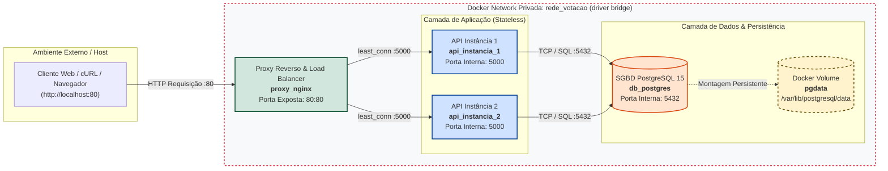
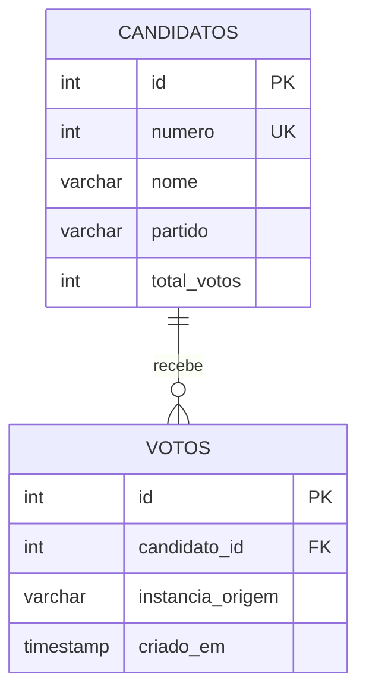

# Relatório Técnico: Prática 1 — Infraestrutura Web e Balanceamento de Carga

**Disciplina:** Sistemas Operacionais Modernos  
<!-- TODO: substituir "Equipe de Desenvolvimento" pelos nomes dos integrantes antes da entrega. -->
**Instituição:** CEFET-MG — Departamento de Computação (DECOM)  
**Docente:** Prof. Michel Pires da Silva  
**Equipe:** Equipe de Desenvolvimento  
**Projeto:** Simulador de Votação com Tolerância a Falhas, Persistência e Alta Disponibilidade  
**Repositório Oficial:** [https://github.com/WilliamDLeao/Simulador-de-Votos](https://github.com/WilliamDLeao/Simulador-de-Votos)

---

## 1. Introdução

Em sistemas operacionais modernos e infraestruturas corporativas, a execução de serviços críticos sob a forma de uma única aplicação monolítica centralizada expõe o ecossistema a graves pontos únicos de falha (*Single Points of Failure* — SPOF). No caso específico de um sistema de votação eletrônica, surtos repentinos de acessos concorrentes e operações frequentes de escrita em disco acarretam contenção de CPU, saturação de filas de rede, exaustão de memória RAM ou bloqueio transacional de tabelas.

Para superar esses desafios, o projeto estrutura um ecossistema de microsserviços conteinerizados distribuídos utilizando o **Docker Compose**. O objetivo da **Prática 1** consiste em implantar e validar experimentalmente uma infraestrutura web resiliente composta por quatro contêineres interdependentes, contemplando:

1. **Ponto Único de Entrada de Borda:** Um servidor **Nginx** operando como Proxy Reverso e Balanceador de Carga exposto na porta pública `80` do sistema hospedeiro.
2. **Camada de Computação Distribuída (*Stateless*):** Duas instâncias idênticas da API de votação desenvolvidas em **Node.js/Express**, que respondem com seus respectivos metadados de contêiner (*hostname* e identificador da instância).
3. **Persistência de Dados Centralizada:** Um Sistema Gerenciador de Banco de Dados relacional **PostgreSQL 15**, desacoplado das réplicas de aplicação.
4. **Isolamento de Armazenamento:** Uso de **Docker Volume** nomeado (`pgdata`) para assegurar que os dados eleitorais persistam de maneira independente do ciclo de vida dos contêineres.
5. **Segurança e Isolamento de Rede:** Rede virtual privada em modo *bridge* (**Docker Network**), garantindo que apenas a porta `80` do proxy reverso seja acessível pelo mundo externo, mantendo as APIs e o banco blindados.

---

## 2. Mapeamento da Solução e Arquitetura

A arquitetura adota a topologia clássica de **Proxy Reverso de Borda com Rede Virtual Isolada**. O cliente externo estabelece comunicação exclusivamente com o contêiner do Nginx através da porta `80`. O Nginx despacha as requisições para as instâncias de backend internas através da rede privada virtual, que por sua vez comunicam-se com a instância de banco de dados central.

### Diagrama Arquitetural da Solução



### Especificação dos Contêineres Orquestrados

| Serviço (`compose`) | Contêiner | Imagem Base | Porta Externa | Porta Interna | Dependência (`depends_on`) |
| :--- | :--- | :--- | :--- | :--- | :--- |
| `nginx` | `proxy_nginx` | `nginx:alpine` | `80:80` (TCP) | 80 | `api1`, `api2` |
| `api1` | `api_instancia_1` | `node:20-alpine` (v20.20.2) | *Nenhuma* | 5000 | `db` |
| `api2` | `api_instancia_2` | `node:20-alpine` (v20.20.2) | *Nenhuma* | 5000 | `db` |
| `db` | `db_postgres` | `postgres:15-alpine` | *Nenhuma* | 5432 | *Nenhuma* |

---

## 3. Tecnologias Utilizadas e Papel dos Componentes

### 3.1. Nginx (Proxy Reverso e Balanceador de Carga)
O serviço `proxy_nginx` emprega a imagem leve `nginx:alpine` e desempenha o papel de intermediário inteligente de borda:
- **Proteção e Encapsulamento de Rede:** É o único componente que expõe porta para o sistema operacional hospedeiro. Clientes externos ignoram a topologia interna, quantidade de instâncias ou credenciais de banco.
- **Algoritmos de escalonamento:** A configuração atual emprega ***Least Connections* (`least_conn`)** (Seção 4.3), que avalia dinamicamente o número de conexões ativas que cada réplica (`api1:5000` e `api2:5000`) possui no momento da chegada da requisição, roteando para a que estiver menos sobrecarregada — escalonamento adequado a sistemas com I/O de banco de dados e tempos transacionais variáveis. O **`ip_hash`** (Seção 4.3.1) foi avaliado como extra, mas **não foi adotado**: as APIs são *stateless*, o roteiro exige alternância no navegador e a afinidade concentraria todo o tráfego de um único cliente em uma réplica. Ambos, além do *Round-Robin* como baseline, foram medidos experimentalmente (Seções 4.3 e 4.3.1).
- **Detecção Passiva de Falhas:** No bloco `upstream`, as réplicas estão configuradas com `max_fails=3` e `fail_timeout=5s`. Se uma instância acumular três falhas dentro da janela de `fail_timeout=5s` (não necessariamente consecutivas), o proxy a remove temporariamente do rodízio por 5 segundos.
- **Otimizações de SO e Transporte:** Utiliza diretivas de alto desempenho como `sendfile on`, `tcp_nopush on`, `tcp_nodelay on` e conexões persistentes com o backend via `keepalive 32` em `HTTP/1.1`.
- **Rastreabilidade de Tráfego:** Injeta o cabeçalho `X-Upstream-Backend $upstream_addr`, permitindo que os clientes e ferramentas de auditoria identifiquem qual endereço interno respondeu.

### 3.2. Docker Engine e Docker Compose (Orquestração e IaC)
- **Virtualização Leve em Nível de SO:** Ao contrário de máquinas virtuais pesadas, os contêineres utilizam os mesmos núcleos do *kernel* do SO hospedeiro, alavancando *Namespaces* (isolamento de processos, pontos de montagem e interfaces de rede) e *cgroups* (limites e contabilidade de CPU e memória).
- **Infraestrutura como Código (IaC):** O arquivo `docker-compose.yml` centraliza a declaração dos 4 serviços, variáveis de ambiente, volumes e redes, tornando a infraestrutura integralmente reprodutível com um único comando.
- **Políticas de Reinicialização:** Todos os serviços utilizam `restart: always`, assegurando autorrecuperação do ecossistema caso qualquer processo finalize anormalmente.

### 3.3. Docker Network (Rede Virtual Privada)
- **Modo Bridge Isolado (`rede_votacao`):** Cria um segmento de rede virtual dedicado no daemon do Docker.
- **Servidor DNS Embutido:** O Docker provê resolução dinâmica de nomes; o Nginx localiza `http://api1:5000` e as APIs localizam `db:5432` automaticamente sem necessidade de IPs estáticos fixados.
- **Resolução dos Upstreams pelo Nginx:** O Nginx resolve `api1` e `api2` na inicialização (ou em uma recarga) e mantém os endereços em cache. Se um contêiner voltar com outro IP após `docker start`, é necessário recarregar ou recriar o proxy para atualizar o `upstream`; a simples atualização do DNS interno não altera a configuração já carregada.
- **Blindagem de Portas:** Somente o Nginx publica porta na interface externa do host. Tentativas de acessar diretamente portas de backend (`5000` ou `5432`) pelo host são rejeitadas pelo firewall interno do SO.

### 3.4. Docker Volume (Persistência e Isolamento de Estado)
- **Desacoplamento do Ciclo de Vida do Contêiner:** A área física de escrita do PostgreSQL reside no volume gerenciado `pgdata`, mapeado em `/var/lib/postgresql/data`. Se o contêiner do SGBD for parado de forma controlada (`docker stop`), excluído (`docker rm`), recriado ou morto abruptamente (`docker kill`), os dados das tabelas permanecem intactos. O teste executado neste trabalho usou `docker stop`, que envia `SIGTERM` e permite desligamento limpo; portanto ele valida persistência, não simula um crash do SGBD.
- **Desempenho Direto de I/O:** Os dados no volume contornam os drivers em camadas do Docker (tradicionalmente *overlay2*; neste host, com Docker 29 e containerd, `docker info` reporta `overlayfs`, conforme a Seção 3.7), obtendo taxa de transferência próxima à velocidade de disco do SO hospedeiro.
- **Declaração no `docker-compose.yml`:** o serviço `db` monta `pgdata:/var/lib/postgresql/data`, e o volume é declarado no bloco `volumes:` com `driver: local` e `name: pgdata`. O nome fixo evita que o Compose prefixe o volume com o nome da pasta do projeto, o que o tornaria "órfão" se o projeto fosse executado a partir de outro diretório.
- **Volume nomeado (*named volume*) em vez de *bind mount*:** o caminho físico é gerenciado pelo Docker (em `/var/lib/docker/volumes/pgdata/_data`), não depende da estrutura de pastas nem das permissões do host, é portável entre Linux, Windows e macOS e evita conflitos de propriedade de arquivos com o usuário `postgres` do contêiner. O *bind mount* foi usado apenas para arquivos somente leitura de configuração (`init.sql` e `nginx.conf`, com `:ro`).
- **Ciclo de vida do volume:** `docker compose down` remove contêineres e rede, mas **preserva** o volume; somente `docker compose down -v` (ou `docker volume rm pgdata`) apaga os dados. O volume pode ser inspecionado com `docker volume ls` e `docker volume inspect pgdata`.
- **Relação com o `init.sql`:** o PostgreSQL só executa os scripts de `/docker-entrypoint-initdb.d/` quando o diretório de dados está **vazio**, isto é, na primeira subida com um volume novo. Reiniciar ou recriar o contêiner com o volume já populado **não** reexecuta o script nem sobrescreve os votos. Para recriar o banco do zero é preciso remover o volume (`down -v`).

### 3.5. Node.js e Express (Microsserviços de Backend)
As instâncias `api_instancia_1` e `api_instancia_2` foram desenvolvidas com Node.js 20 e Express:
- **Natureza *Stateless*:** Nenhum estado transacional (votos acumulados, sessões) é armazenado em variáveis de memória local. Cada requisição é autossuficiente e delega a gravação ao PostgreSQL.
- **Auditoria e Diagnóstico:** Cada resposta inclui o identificador do contêiner obtido via `os.hostname()` e o nome lógico injetado por variável de ambiente (`INSTANCE_NAME`), permitindo a comprovação em tempo real do balanceamento de carga.
- **Conectividade Eficiente:** Utilização da biblioteca `pg` com pool de até 10 conexões concorrentes por instância.
- **Rotas Implementadas:**
  * `GET /`: Health check da API e diagnóstico da conectividade com o banco (`SELECT 1`).
  * `GET /candidatos`: Listagem ordenada dos candidatos cadastrados e seus totais parciais.
  * `POST /votar`: Registro atômico e transacional do voto.
  * `GET /apuracao`: Totalização consolidada e cálculo percentual dinâmico dos votos por candidato.

### 3.6. PostgreSQL 15 (Banco de Dados Relacional)
- **Garantias ACID:** Garante atomicidade e isolamento na concorrência de escritas na tabela de votos.
- **Contenção na Atualização do Contador:** A rota `POST /votar` executa um CTE com `UPDATE candidatos SET total_votos = total_votos + 1` na linha do candidato. Esse incremento na mesma tupla serializa as escritas concorrentes direcionadas ao mesmo candidato: o isolamento ACID evita perdas, mas constitui o gargalo esperado sob carga de escrita. Essa contenção **não foi medida** nos benchmarks da Seção 4.3, que usam apenas `GET /`.
- **Script de Inicialização Automática (`database/init.sql`):** Montado em `/docker-entrypoint-initdb.d/init.sql:ro`, o script é acionado na primeira inicialização do banco para criar as tabelas `candidatos` e `votos`, além de popular os registros iniciais (Candidato A: 10, Candidato B: 20 e Voto Nulo: 99).
- **Atomicidade via SQL CTE:** O registro do voto e a contabilização na tabela de candidatos são processados em um único *round-trip* via `WITH updated AS (...) INSERT INTO votos ...`, eliminando *race conditions*.

#### 3.6.1. Configuração do Contêiner do SGBD

O serviço `db` (contêiner `db_postgres`) é definido no `docker-compose.yml` com os parâmetros abaixo:

| Parâmetro | Valor | Finalidade |
| :--- | :--- | :--- |
| `image` | `postgres:15-alpine` | Imagem oficial do PostgreSQL 15 em base Alpine (leve) |
| `container_name` | `db_postgres` | Nome fixo, usado nos comandos `docker exec` e nos scripts de teste |
| `POSTGRES_DB` | `votacao` | Banco criado automaticamente na primeira inicialização |
| `POSTGRES_USER` | `postgres` | Superusuário do banco |
| `POSTGRES_PASSWORD` | `postgres` | Senha do superusuário (ambiente acadêmico; ver §3.6.3) |
| `volumes` | `pgdata:/var/lib/postgresql/data` | Persistência dos dados (Docker Volume, §3.4) |
| `volumes` | `./database/init.sql:/docker-entrypoint-initdb.d/init.sql:ro` | Criação do schema e carga inicial (somente leitura) |
| `networks` | `rede_votacao` (*bridge*) | Rede privada compartilhada com as APIs |
| `ports` | *(nenhuma publicada)* | A porta `5432` existe apenas dentro da rede interna |
| `restart` | `always` | Reinício automático em caso de falha |

As APIs localizam o banco pelo nome do serviço (`DB_HOST=db`, `DB_PORT=5432`), resolvido pelo DNS embutido do Docker, e usam as mesmas credenciais por variáveis de ambiente.

#### 3.6.2. Schema da Tabela de Votos (`database/init.sql`)

O schema é composto por duas tabelas relacionadas:

| Tabela | Coluna | Tipo | Restrições | Função |
| :--- | :--- | :--- | :--- | :--- |
| `candidatos` | `id` | `SERIAL` | PK | Identificador interno |
| | `numero` | `INT` | `UNIQUE`, `NOT NULL` | Número do candidato na votação (10, 20, 99) |
| | `nome` | `VARCHAR(100)` | `NOT NULL` | Nome do candidato |
| | `partido` | `VARCHAR(50)` | `NOT NULL` | Partido |
| | `total_votos` | `INT` | `DEFAULT 0` | Contador acumulado, usado para a apuração rápida |
| `votos` | `id` | `SERIAL` | PK | Identificador do voto |
| | `candidato_id` | `INT` | FK → `candidatos(id)` | Candidato escolhido |
| | `instancia_origem` | `VARCHAR(50)` | `NOT NULL` | Instância da API que processou o voto (rastreabilidade do balanceamento) |
| | `criado_em` | `TIMESTAMP` | `DEFAULT CURRENT_TIMESTAMP` | Momento do registro |



*Figura — Diagrama entidade-relacionamento do banco `votacao`.*

**Decisões de projeto:**
- **Tabela de auditoria + contador:** cada voto gera uma linha em `votos` (histórico, horário e instância de origem) e incrementa `candidatos.total_votos` (leitura rápida em `GET /apuracao`, sem `COUNT(*)` sobre todos os votos).
- **Consistência entre as duas tabelas:** o INSERT e o UPDATE ocorrem na mesma instrução (CTE), em uma única transação (o custo dessa garantia é a contenção do `UPDATE` na linha do candidato, descrita no início da §3.6). Assim, a soma de `total_votos` deve ser sempre igual ao número de linhas de `votos`. A verificação manual é:
  ```sql
  SELECT (SELECT SUM(total_votos) FROM candidatos) AS soma_contadores,
         (SELECT COUNT(*) FROM votos)              AS linhas_votos;
  ```
- **Candidato 99 (Voto Nulo / Branco):** tratado como um candidato especial, o que simplifica a apuração e o cálculo percentual.
- **Idempotência do script:** `CREATE TABLE IF NOT EXISTS` e `INSERT ... ON CONFLICT (numero) DO NOTHING` impedem erros ou duplicações caso o script seja executado novamente.

#### 3.6.3. Limitações Conhecidas e Melhorias Possíveis

- **Credenciais em texto puro:** usuário e senha (`postgres`/`postgres`) estão no `docker-compose.yml`, aceitável em ambiente acadêmico. Em produção, o ideal é usar arquivo `.env` fora do versionamento ou *Docker secrets*, além de um usuário de aplicação com privilégios mínimos.
- **Ausência de `healthcheck` no contêiner do banco:** sem ele, o `depends_on` das APIs só garante que o contêiner foi iniciado, não que o PostgreSQL já aceita conexões. Um `healthcheck` com `pg_isready` resolveria isso.
- **`candidato_id` aceita `NULL`:** a coluna não possui `NOT NULL`; a aplicação sempre informa o candidato, mas a restrição no banco reforçaria a integridade.

---

### 3.7. Ambiente de Execução — Notebook e Configuração do Sistema

As medições da Seção 4 foram realizadas em **19/11/2026** (Round-Robin, `least_conn`, persistência e isolamento) e **20/11/2026** (`ip_hash`), com o notebook operando no **perfil de desempenho (economia de bateria desativada)**. O ambiente físico e as versões de software utilizados foram:

| Item | Configuração observada |
| :--- | :--- |
| **Notebook** | Acer **Nitro ANV15-51** (placa `Sportage_RTH`, BIOS V1.60 de 08/04/2026), chassi `laptop` |
| **Identificação do host** | `tutus-house` (usuário `tutu`) |
| **Processador** | 13th Gen Intel(R) Core(TM) **i5-13420H** — 8 núcleos físicos / 12 *threads* lógicos, até 4,60 GHz, cache L3 de 12 MiB, x86-64, VT-x |
| **Perfil de energia** | Economia de bateria **desativada** — modo de desempenho |
| **Memória RAM** | 7,5 GiB (~8 GB); *swap* de 7,5 GiB em `/dev/nvme0n1p6` |
| **Armazenamento** | SSD NVMe `/dev/nvme0n1p7` — 54 GB no total, ~12 GB livres no momento dos testes (78% ocupado) |
| **Sistema operacional** | **Linux Mint 22.3 (Zena)**, kernel `6.17.0-35-generic`, x86-64 |
| **Fuso horário** | `America/Sao_Paulo` (UTC-3), relógio sincronizado por NTP |
| **Docker Engine** | **29.9.3** (Community), API 1.56, Go 1.26.10, containerd v2.4.2, runc 1.5.2 |
| **Docker Compose** | **v5.7.0** |
| **Docker — runtime** | driver de armazenamento `overlayfs`, cgroup driver `systemd`, **cgroup v2**, runtime `runc`, raiz `/var/lib/docker` |
| **Recursos visíveis ao daemon** | `NCPU=12` e `MemTotal=8.014.266.368` bytes (~7,47 GiB) |
| **Node.js no host** (script de teste) | v26.13.0 |
| **Node.js nos contêineres da API** | v20.20.2 (imagem `node:20-alpine`) |
| **Nginx no contêiner** | nginx/1.31.8 |
| **PostgreSQL no contêiner** | psql 15.19 (imagem `postgres:15-alpine`) |
| **Carga média do host** | `load average: 1,29, 0,76, 0,80` logo antes dos testes |

> **Observação metodológica:** o Docker roda **nativamente** sobre o kernel Linux do notebook (não dentro de uma VM do Docker Desktop). Portanto, os limites de CPU e memória percebidos pelos contêineres são os do próprio hardware acima, sem uma camada de virtualização adicional. O perfil de desempenho permite frequências mais altas (até 4,60 GHz), mas a ordem de grandeza das vazões e latências em *loopback* depende também de *keepalive*, pools de conexão, escalonador do Nginx, cache do sistema operacional e da própria máquina; por isso não se atribui a diferença apenas ao perfil de energia. Os números são evidências de funcionamento em execuções curtas, não um *benchmark* rigoroso.

---

## 4. Execução e Validação Experimental

Nesta seção documenta-se o passo a passo com as evidências e saídas de comandos obtidas durante a execução do ambiente.

### 4.1. Subida da Infraestrutura
A inicialização do ambiente ocorre na raiz do projeto com o comando:
```bash
docker compose up --build -d
```

Ao inspecionar o status dos contêineres via `docker compose ps`:
```text
NAME                IMAGE                  COMMAND                  SERVICE   STATUS   PORTS
api_instancia_1     simulador-votos-api1   "docker-entrypoint.s…"   api1      Up       5000/tcp
api_instancia_2     simulador-votos-api2   "docker-entrypoint.s…"   api2      Up       5000/tcp
db_postgres         postgres:15-alpine     "docker-entrypoint.s…"   db        Up       5432/tcp
proxy_nginx         nginx:alpine           "/docker-entrypoint.…"   nginx     Up       0.0.0.0:80->80/tcp
```
> **Resultado:** Os quatro contêineres sobem de forma coordenada (Figura 1). Apenas a porta `80` está vinculada à interface do hospedeiro.


*Figura 1 — Evidência visual dos quatro contêineres ativos (`proxy_nginx`, `api_instancia_1`, `api_instancia_2` e `db_postgres`), com apenas a porta `80` publicada no hospedeiro.*

---

### 4.2. Validação do Balanceamento de Carga e Alternância de Instâncias

Para validar a alternância das requisições na porta `80`, foram criados dois scripts na pasta `scripts/`:
- `scripts/test_load_balancer.ps1` (PowerShell para ambientes Windows)
- `scripts/test_load_balancer.js` (Node.js multiplataforma com medição de latência)

Executando o script `scripts/test_load_balancer.js` para uma rajada de 10 requisições:
```bash
node scripts/test_load_balancer.js 10
```

#### Evidência de Execução (Log Obtido em 19/11/2026):
```text
==============================================================================
🚀 SIMULADOR DE CARGA E BENCHMARK DE LATÊNCIA — NGINX
• URL Alvo:         http://localhost:80/
• Total de Carga:   10 requisições
• Concorrência:     1 simultânea(s)
==============================================================================
[Req #001] Status: 200 | Respondido por: Instancia-2  | Container: 5eaf4bfa | Latência:   12.9 ms
[Req #002] Status: 200 | Respondido por: Instancia-1  | Container: 0cb33ff8 | Latência:   2.70 ms
[Req #003] Status: 200 | Respondido por: Instancia-2  | Container: 5eaf4bfa | Latência:   1.35 ms
[Req #004] Status: 200 | Respondido por: Instancia-1  | Container: 0cb33ff8 | Latência:   4.35 ms
[Req #005] Status: 200 | Respondido por: Instancia-2  | Container: 5eaf4bfa | Latência:   1.56 ms
[Req #006] Status: 200 | Respondido por: Instancia-1  | Container: 0cb33ff8 | Latência:   1.60 ms
[Req #007] Status: 200 | Respondido por: Instancia-2  | Container: 5eaf4bfa | Latência:   1.61 ms
[Req #008] Status: 200 | Respondido por: Instancia-1  | Container: 0cb33ff8 | Latência:   1.61 ms
[Req #009] Status: 200 | Respondido por: Instancia-2  | Container: 5eaf4bfa | Latência:   1.53 ms
[Req #010] Status: 200 | Respondido por: Instancia-1  | Container: 0cb33ff8 | Latência:   1.04 ms

==============================================================================
📊 RESUMO DO BALANCEAMENTO E PERFORMANCE
==============================================================================
• Tempo total do teste:    0.03 segundos
• Vazão (Throughput):      301.7 requisições/segundo
• Requisições com sucesso: 10 de 10

⚖️  DISTRIBUIÇÃO DE CARGA ENTRE AS INSTÂNCIAS:
  * Instancia-2   :   5 reqs ( 50.0%) | Latência Média: 3.80 ms (Min: 1.35 ms / Max: 12.9 ms)
  * Instancia-1   :   5 reqs ( 50.0%) | Latência Média: 2.26 ms (Min: 1.04 ms / Max: 4.35 ms)

⏱️  MÉTRICAS GERAIS DE LATÊNCIA (Resposta do Nginx):
  * Mínima:  1.04 ms
  * Média:   3.03 ms
  * P50 (Mediana): 1.61 ms
  * P95:     12.9 ms
  * Máxima:  12.9 ms
==============================================================================
```

> **Comprovação:** A distribuição de carga atingiu taxa exata de **50% para a Instancia-1** e **50% para a Instancia-2**, com identificação clara de dois contêineres distintos (`0cb33ff8` e `5eaf4bfa`), satisfazendo plenamente o requisito de balanceamento. Como as requisições foram **sequenciais** (concorrência 1), ambas as réplicas permanecem com zero conexões ativas entre uma chamada e outra; o `least_conn` empataria e o desempate seguiria a ordem do `upstream`, comportamento indistinguível do *Round-Robin*. Portanto, este teste prova que o balanceamento alcança os dois contêineres, mas **não identifica qual algoritmo estava ativo**. A confirmação do algoritmo veio da configuração efetiva (`nginx -T`) e da comparação controlada da Seção 4.3. O cabeçalho `X-Upstream-Backend` confirma o endereço interno do backend escolhido em cada resposta.

---

### 4.3. Avaliação Experimental: *Round-Robin* (baseline) vs *Least Connections*

O roteiro prático solicita a avaliação dos escalonamentos disponíveis tendo o **Round-Robin como baseline**. Para medir os dois algoritmos, a diretiva `least_conn;` do bloco `upstream` foi temporariamente comentada para a coleta do baseline e depois reativada. A troca foi aplicada a quente, sem reiniciar os contêineres:

```bash
docker exec proxy_nginx nginx -t          # valida a sintaxe antes de recarregar
docker exec proxy_nginx nginx -s reload   # aplica a nova configuração
```

Para cada algoritmo foram feitas **3 repetições** da seguinte carga (50 requisições GET, 10 concorrentes):

```bash
node scripts/test_load_balancer.js 50 10
```

#### Resultados obtidos

| Algoritmo | Execução | Distribuição (I1 / I2) | Latência média | P95 | Vazão |
| :--- | :---: | :---: | :---: | :---: | :---: |
| Round-Robin (baseline) | 1 | 25 / 25 (50% / 50%) | 15,3 ms | 58,3 ms | 590,2 req/s |
| Round-Robin (baseline) | 2 | 25 / 25 (50% / 50%) | 6,19 ms | 14,7 ms | 1350,9 req/s |
| Round-Robin (baseline) | 3 | 25 / 25 (50% / 50%) | 6,40 ms | 17,4 ms | 1351,9 req/s |
| **Média Round-Robin** | — | **50% / 50%** | **9,30 ms** | **30,13 ms** | **1097,7 req/s** |
| `least_conn` | 1 | 27 / 23 (54% / 46%) | 4,45 ms | 10,1 ms | 1896,0 req/s |
| `least_conn` | 2 | 27 / 23 (54% / 46%) | 5,21 ms | 13,9 ms | 1613,9 req/s |
| `least_conn` | 3 | 28 / 22 (56% / 44%) | 5,40 ms | 15,8 ms | 1609,9 req/s |
| **Média `least_conn`** | — | **≈ 54% / 46%** | **5,02 ms** | **13,27 ms** | **1706,6 req/s** |

#### Análise comparativa

- **Round-Robin (baseline):** mais uma vez foi determinístico — **25 requisições para cada instância nas três execuções**. A primeira medição foi penalizada pelo *cold start* (P95 de 58,3 ms, incluindo o estabelecimento das primeiras conexões e o aquecimento do *pool* do PostgreSQL); já aquecido, ficou entre 6,19 ms e 6,40 ms de latência média e P95 de 14,7 ms a 17,4 ms.
- **`least_conn` (configuração daquele experimento):** a distribuição foi adaptativa (54/46, 54/46 e 56/44), sem desequilíbrio relevante, e apresentou **menor latência média nas três repetições** (4,45 ms, 5,21 ms e 5,40 ms) e maior vazão (1609,9 a 1896,0 req/s).
- **Conclusão:** neste experimento — realizado no notebook descrito na §3.7 — o `least_conn` saiu numericamente à frente em todas as repetições (médias de 5,02 ms contra 9,30 ms; P95 de 13,27 ms contra 30,13 ms; vazão de 1706,6 contra 1097,7 req/s). Parte dessa diferença é atribuível ao fato de o baseline ter sido medido **primeiro**, absorvendo o *cold start*; mesmo comparando apenas as execuções aquecidas a vantagem se mantém, porém menor (≈5,3 ms contra ≈6,3 ms), e as faixas de P95 se sobrepõem parcialmente (14,7–17,4 ms contra 10,1–15,8 ms). Portanto, **não se afirma superioridade rigorosa**: o resultado é uma tendência favorável, coerente com o domínio do problema. Com requisições de custo desigual (por exemplo, `POST /votar` com contenção de gravação ou `GET /apuracao` mais demorada), o `least_conn` desvia o fluxo da réplica com mais conexões ativas, enquanto o Round-Robin enviaria a próxima requisição apenas por ordem cíclica. O `least_conn` **permanece como configuração final**, atendendo ao requisito de alternância do roteiro; o `ip_hash` foi avaliado como extra (Seção 4.3.1) e não foi adotado, e o Round-Robin permanece documentado como baseline.

> **Nota metodológica:** os números acima são de execuções curtas no mesmo host e servem como evidência de funcionamento e tendência, não como benchmark rigoroso. O script `test_load_balancer.js` mede a latência ponta a ponta no cliente, incluindo o tempo de conexão/keepalive do Nginx. A ordem de execução (Round-Robin primeiro, `least_conn` depois) é um viés conhecido deste experimento.

> **Limitação sobre escrita:** todas as medições acima utilizam `GET /`. Elas não medem, portanto, a contenção de gravação de `POST /votar`, cujo `UPDATE` na mesma linha de `candidatos` serializa os incrementos (Seção 3.6). A recomendação do `least_conn` para cargas transacionais é justificada pelo princípio de desviar conexões ativas, mas não foi quantificada neste experimento.

#### 4.3.1. Avaliação Experimental: IP Hash (afinidade por cliente)

Como complemento à comparação anterior, a diretiva `least_conn;` foi substituída por `ip_hash;` no bloco `upstream` (ver `scripts/trocar_algoritmo.sh`). O `ip_hash` calcula um hash do endereço IP de origem (os três primeiros octetos, para IPv4) e encaminha a requisição sempre para a mesma réplica — mecanismo de *afinidade de sessão* (*session affinity*). A configuração efetiva foi conferida dentro do contêiner antes da coleta:

```bash
docker exec proxy_nginx nginx -T | grep -A6 'upstream simulador_votacao'
# upstream simulador_votacao {
#     ip_hash;
#     server api1:5000 max_fails=3 fail_timeout=5s;
#     server api2:5000 max_fails=3 fail_timeout=5s;
#     keepalive 32;
# }
```

> **Nota de aplicação da configuração:** na versão inicial usada durante a coleta de 20/11/2026, o script `trocar_algoritmo.sh` editava o arquivo diretamente com `sed -i`, que substitui o inode do arquivo. Como `nginx.conf` é injetado por *bind mount* (`./nginx/nginx.conf:/etc/nginx/nginx.conf:ro`), o contêiner continuava enxergando o inode antigo mesmo após `nginx -s reload`, sendo necessário recriar o proxy (`docker compose up -d --force-recreate nginx`). Posteriormente, o script foi corrigido para gravar via arquivo temporário (`mktemp`) e redirecionamento (`cat "$TMP" > "$CONF"`), preservando o inode original para que o `nginx -s reload` funcione diretamente.

Executando novamente o teste de 10 requisições sequenciais em 20/11/2026:

```bash
node scripts/test_load_balancer.js 10
```

#### Evidência de Execução (Log Obtido em 20/11/2026):
```text
==============================================================================
🚀 SIMULADOR DE CARGA E BENCHMARK DE LATÊNCIA — NGINX
• URL Alvo:         http://localhost:80/
• Total de Carga:   10 requisições
• Concorrência:     1 simultânea(s)
==============================================================================
[Req #001] Status: 200 | Respondido por: Instancia-2  | Container: 5eaf4bfa | Latência:   6.80 ms
[Req #002] Status: 200 | Respondido por: Instancia-2  | Container: 5eaf4bfa | Latência:   1.97 ms
[Req #003] Status: 200 | Respondido por: Instancia-2  | Container: 5eaf4bfa | Latência:   0.93 ms
[Req #004] Status: 200 | Respondido por: Instancia-2  | Container: 5eaf4bfa | Latência:   3.79 ms
[Req #005] Status: 200 | Respondido por: Instancia-2  | Container: 5eaf4bfa | Latência:   1.12 ms
[Req #006] Status: 200 | Respondido por: Instancia-2  | Container: 5eaf4bfa | Latência:   1.25 ms
[Req #007] Status: 200 | Respondido por: Instancia-2  | Container: 5eaf4bfa | Latência:   0.78 ms
[Req #008] Status: 200 | Respondido por: Instancia-2  | Container: 5eaf4bfa | Latência:   1.08 ms
[Req #009] Status: 200 | Respondido por: Instancia-2  | Container: 5eaf4bfa | Latência:   1.36 ms
[Req #010] Status: 200 | Respondido por: Instancia-2  | Container: 5eaf4bfa | Latência:   1.33 ms

==============================================================================
📊 RESUMO DO BALANCEAMENTO E PERFORMANCE
==============================================================================
• Tempo total do teste:    0.02 segundos
• Vazão (Throughput):      452.0 requisições/segundo
• Requisições com sucesso: 10 de 10

⚖️  DISTRIBUIÇÃO DE CARGA ENTRE AS INSTÂNCIAS:
  * Instancia-2   :  10 reqs (100.0%) | Latência Média: 2.04 ms (Min: 0.78 ms / Max: 6.80 ms)

⏱️  MÉTRICAS GERAIS DE LATÊNCIA (Resposta do Nginx):
  * Mínima:  0.78 ms
  * Média:   2.04 ms
  * P50 (Mediana): 1.33 ms
  * P95:     6.80 ms
  * Máxima:  6.80 ms
==============================================================================
```

> **Comprovação:** diferente do experimento com `least_conn`, não houve alternância: as **10 requisições foram integralmente atendidas pela `Instancia-2`** (`5eaf4bfa`, endereço interno `172.18.0.3:5000`, confirmado pelo cabeçalho `X-Upstream-Backend`). Isso é exatamente o comportamento esperado do `ip_hash`: como todo o tráfego de teste parte de um único cliente (`localhost`), o hash do IP sempre seleciona a mesma réplica. A afinidade não é um desequilíbrio acidental nem uma falha do balanceador.

Para manter o mesmo protocolo do experimento anterior, foram feitas **3 repetições** de 50 requisições GET com concorrência 10:

```bash
node scripts/test_load_balancer.js 50 10
```

| Algoritmo | Execução | Distribuição (I1 / I2) | Latência média | P95 | Vazão |
| :--- | :---: | :---: | :---: | :---: | :---: |
| `ip_hash` | 1 | 0 / 50 (0% / 100%) | 5,79 ms | 14,7 ms | 1340,5 req/s |
| `ip_hash` | 2 | 0 / 50 (0% / 100%) | 6,42 ms | 28,7 ms | 1358,5 req/s |
| `ip_hash` | 3 | 0 / 50 (0% / 100%) | 4,79 ms | 12,4 ms | 1734,2 req/s |
| **Média `ip_hash`** | — | **0% / 100%** | **5,67 ms** | **18,60 ms** | **1477,7 req/s** |

**Teste de failover da réplica fixa.** Para verificar se a afinidade não compromete a disponibilidade, a instância selecionada pelo hash (`api_instancia_2`) foi parada e o proxy foi consultado três vezes:

```bash
docker stop api_instancia_2
curl -s http://localhost/   # ×3 → "instancia":"Instancia-1"
docker start api_instancia_2
# após ~6 s (fail_timeout): "instancia":"Instancia-2"
```

As três requisições durante a falha foram atendidas pela `Instancia-1`, e cerca de 6 segundos após a recuperação o tráfego retornou à `Instancia-2`. Portanto, os parâmetros `max_fails=3` / `fail_timeout=5s` continuam protegendo a disponibilidade mesmo com afinidade por IP.

**Análise:** o `ip_hash` troca a distribuição uniforme por previsibilidade de origem. Com um único IP de teste toda a carga concentra-se em uma réplica (100% na `Instancia-2`); em produção, com muitos IPs distintos, o hash tende a distribuir os clientes entre as duas réplicas, mas sem o ajuste dinâmico do `least_conn`. Como as APIs são *stateless* e compartilham o mesmo PostgreSQL, a afinidade não traz ganho funcional neste projeto e pode concentrar carga; ela seria vantajosa apenas se houvesse estado local de sessão. Há ainda duas ressalvas operacionais: um proxy ou NAT à frente do Nginx faz todos os clientes aparecerem com o mesmo IP, e para IPv4 o hash considera apenas os três primeiros octetos. A latência média (5,67 ms) ficou próxima da tendência medida para o `least_conn` (5,02 ms), e a vazão média (1477,7 req/s) situou-se entre o baseline e o `least_conn`, com P95 mais instável (18,60 ms, influenciado pelo pico de 28,7 ms registrado na tabela de resultados do `ip_hash` desta seção). Por todos esses motivos — ausência de estado local, exigência de alternância no navegador e risco de concentração — o `ip_hash` **não foi adotado como configuração final**. O `least_conn` segue ativo; `ip_hash` e Round-Robin permanecem documentados como alternativas avaliadas. O teste de parada da réplica fixa descrito acima, sim, comprova a detecção passiva: ao contrário do teste da Seção 4.5, aqui o tráfego tinha uma réplica alternativa para a qual migrar mesmo com a afinidade ativa.

> **Nota metodológica:** os números acima são de execuções curtas no mesmo host (20/11/2026) e servem como evidência de funcionamento, não como benchmark rigoroso. A concentração em uma única instância é consequência direta de todo o tráfego de teste originar-se de `localhost`.

---

### 4.4. Teste de Tolerância a Falhas e Persistência (Docker Volume)

O teste de resiliência e persistência foi realizado em **19/11/2026** no ambiente descrito na §3.7. Antes da inserção dos votos de teste, o volume `pgdata` continha **2570 votos**; portanto os totais absolutos abaixo são elevados. O que se valida é a **igualdade antes/depois**, não o valor absoluto.

#### Passo 1: Inserção de Votos
Realizou-se a inserção de dois votos via `POST /votar`. Apenas a resposta de uma delas foi registrada abaixo (atendida pela `Instancia-2`); a instância que atendeu a segunda requisição não foi anotada, portanto não se afirma que foram réplicas diferentes:
```bash
curl -X POST http://localhost/votar -H "Content-Type: application/json" -d '{"numero": 10}'
curl -X POST http://localhost/votar -H "Content-Type: application/json" -d '{"numero": 20}'
```
```json
{ "sucesso": true, "mensagem": "Voto computado com sucesso para Candidato A (10)!",
  "candidato": { "numero": 10, "nome": "Candidato A", "totalVotosAtualizado": 2534 },
  "processadoPor": { "instancia": "Instancia-2", "hostname": "5eaf4bfaecb3" },
  "timestamp": "2026-11-19T16:55:30.939Z" }
```

#### Passo 2: Verificação da Apuração
Consulta em `GET /apuracao` confirmando os votos persistidos (total 2572):
```json
{
  "sucesso": true,
  "totalVotosGeral": 2572,
  "apuracao": [
    { "numero": 10, "nome": "Candidato A", "partido": "Partido A", "total_votos": 2534, "percentual": "98.52%" },
    { "numero": 20, "nome": "Candidato B", "partido": "Partido B", "total_votos": 38, "percentual": "1.48%" },
    { "numero": 99, "nome": "Voto Nulo / Branco", "partido": "Nenhum", "total_votos": 0, "percentual": "0.00%" }
  ]
}
```

#### Passo 3: Parada Controlada do SGBD (`docker stop`)
O contêiner do PostgreSQL foi parado de forma controlada:
```bash
docker stop db_postgres
```
O comando `docker ps --filter name=db_postgres` confirmou o contêiner fora do ar (sem status `Up`). Como `docker stop` envia `SIGTERM` e permite desligamento limpo, este é um teste de **disponibilidade e persistência**, não de crash abrupto; para simular falha súbita seria necessário `docker kill db_postgres`, o que não foi executado nesta etapa.

#### Passo 4: Comportamento da Aplicação sob Indisponibilidade
Ao submeter requisições à API durante o período de inatividade do banco, os nós Node.js não travaram. A rota `/apuracao` retornou de forma defensiva o status HTTP `503 Service Unavailable`:
```json
{
  "sucesso": false,
  "mensagem": "Banco de dados temporariamente indisponível",
  "erro": "Connection terminated due to connection timeout",
  "processadoPor": { "instancia": "Instancia-1", "hostname": "0cb33ff83fe4" },
  "timestamp": "2026-11-19T16:55:39.114Z"
}
```
Já o *health check* `GET /` continuou respondendo `HTTP 200` com `"status":"online"` e `"banco":"desconectado"` — evidência de que apenas a camada de dados estava fora, não a aplicação.

#### Passo 5: Restauração do Serviço e Validação da Persistência
O contêiner do PostgreSQL foi iniciado novamente e, após 12 segundos, já estava com status `Up`:
```bash
docker start db_postgres
```

Após o restabelecimento, a rota `/apuracao` devolveu **exatamente o mesmo total (2572)**:
```json
{
  "sucesso": true,
  "totalVotosGeral": 2572,
  "apuracao": [
    { "numero": 10, "nome": "Candidato A", "partido": "Partido A", "total_votos": 2534, "percentual": "98.52%" },
    { "numero": 20, "nome": "Candidato B", "partido": "Partido B", "total_votos": 38, "percentual": "1.48%" },
    { "numero": 99, "nome": "Voto Nulo / Branco", "partido": "Nenhum", "total_votos": 0, "percentual": "0.00%" }
  ]
}
```
A inspeção SQL direta confirmou os mesmos valores gravados no volume:
```text
 numero |        nome        | total_votos
--------+--------------------+-------------
     10 | Candidato A        |        2534
     20 | Candidato B        |          38
     99 | Voto Nulo / Branco |           0
(3 rows)
```

> **Comprovação:** `2572` votos antes do `docker stop` e `2572` votos depois do `docker start` — **nenhum voto foi perdido**. Mesmo após a paralisação completa do contêiner do SGBD, o total e a integridade das tabelas foram preservados graças ao Docker Volume gerenciado `pgdata`.

---

### 4.5. Teste de Falha de um Container Individual

Além da queda do banco (Seção 4.4), foi desenvolvido o script `scripts/demo_falha_container.sh`, que generaliza o teste para qualquer um dos quatro containers (`proxy_nginx`, `api_instancia_1`, `api_instancia_2` e `db_postgres`). O objetivo é provar que a falha de **um** componente não derruba os demais e que nenhum voto confirmado é perdido.

#### Como executar

Com a stack no ar (`docker compose up --build -d`) e a partir da raiz do projeto:

```bash
bash scripts/demo_falha_container.sh [container] [votos]
bash scripts/demo_falha_container.sh                      # api_instancia_1, 20 votos
bash scripts/demo_falha_container.sh api_instancia_2 50
bash scripts/demo_falha_container.sh db_postgres 20
```

Para acompanhar visualmente, em dois outros terminais (no Git Bash, onde `watch` não existe):

```bash
while true; do clear; docker ps -a --format "table {{.Names}}\t{{.Status}}"; sleep 1; done
while true; do clear; docker exec db_postgres psql -U postgres -d votacao -c "SELECT numero, nome, total_votos FROM candidatos ORDER BY numero;"; sleep 1; done
```

#### Procedimento do script

1. Exibe o estado dos 4 containers.
2. Registra a contagem de votos antes da falha (soma de `candidatos.total_votos` e quantidade de linhas na tabela de auditoria `votos`).
3. Executa `docker stop` no container-alvo (queda controlada e repetível, conforme o roteiro da prática).
4. Envia `N` requisições `POST /votar` pelo Nginx com o alvo fora do ar, contando as confirmadas (HTTP 200) e a instância que atendeu cada uma.
5. Exibe novamente o estado dos containers, mostrando que os demais seguem em execução.
6. Executa `docker start` no alvo (se for o banco, aguarda `pg_isready`).
7. Compara a contagem final com a esperada (`antes + votos confirmados`) e imprime `OK` ou `ATENÇÃO`.

#### Critério de sucesso e comportamento esperado

| Alvo | Durante a falha | Resultado esperado |
| :--- | :--- | :--- |
| `api_instancia_1` ou `api_instancia_2` | O Nginx isola a instância indisponível (`max_fails`/`fail_timeout`) e envia o fluxo à saudável | 100% dos votos confirmados; contagem final = antes + enviados |
| `db_postgres` | A API responde HTTP 503 | Votos recusados não são contabilizados; dados anteriores preservados pelo Docker Volume |
| `proxy_nginx` | Porta 80 sem resposta | Nenhum voto confirmado; dados intactos |

O teste é aprovado quando a soma dos contadores e o número de registros em `votos` coincidem com o valor esperado (`OK` ao final).

#### Resultados após executar `scripts/demo_falha_container.sh`:

```text
=== 1. Estado inicial dos 4 containers ===
  proxy_nginx        running
  api_instancia_1    running
  api_instancia_2    running
  db_postgres        running

=== 2. Contagem de votos ANTES da falha ===
  Soma dos contadores : 2572
  Registros em 'votos': 2572

=== 3. FALHA: docker stop api_instancia_1 ===
  api_instancia_1 parado.
  proxy_nginx        running
  api_instancia_1    exited
  api_instancia_2    running
  db_postgres        running

=== 4. Enviando 20 votos pelo Nginx com api_instancia_1 fora do ar ===
  Votos confirmados (HTTP 200): 20
  Votos recusados/erro        : 0
  Atendidos por Instancia-2: 20

=== 5. Os demais containers continuam rodando? ===
  proxy_nginx        running
  api_instancia_1    exited
  api_instancia_2    running
  db_postgres        running

=== 6. RECUPERAÇÃO: docker start api_instancia_1 ===
  api_instancia_1 iniciado.
  proxy_nginx        running
  api_instancia_1    running
  api_instancia_2    running
  db_postgres        running

=== 7. Contagem de votos DEPOIS ===
  Soma dos contadores : 2592 (esperado: 2592)
  Registros em 'votos': 2592 (esperado: 2592)

=== RESULTADO ===
  OK: nenhum voto confirmado foi perdido
```

Na execução registrada o algoritmo ativo era `least_conn` (configuração final) e o alvo foi `api_instancia_1`. Como restava apenas `api_instancia_2` no `upstream`, o encaminhamento dos 20 votos para ela era a única rota possível: o resultado demonstra continuidade do serviço, mas não isola a ação de `max_fails`/`fail_timeout`. Portanto, o `OK` comprova a **continuidade do serviço e a integridade dos votos confirmados** quando uma réplica de API é parada; ele não prova, isoladamente, que o Nginx tenha "isolado" a réplica. A evidência explícita de detecção passiva está na Seção 4.3.1, onde a réplica fixa pelo `ip_hash` falhou enquanto ainda existia outra réplica disponível.

### 4.6. Teste de Isolamento de Rede

Comprovando o isolamento da Docker Network `rede_votacao`, tentou-se conexão direta às portas dos serviços a partir do terminal do hospedeiro:

```bash
# 1. Tentativa de conexão na porta interna da API (5000):
curl http://localhost:5000/
# curl: (7) Failed to connect to localhost:5000 after 0 ms: Could not connect to server

# 2. Tentativa de conexão na porta interna do PostgreSQL (5432):
curl http://localhost:5432
# curl: (7) Failed to connect to localhost:5432 after 0 ms: Could not connect to server

# 3. Controle: porta pública do proxy (80):
curl -o /dev/null -w 'HTTP %{http_code}\n' http://localhost/
# HTTP 200
```

> **Comprovação:** As portas `5000` e `5432` não possuem publicação (`ports:`) no `docker-compose.yml` e, portanto, não possuem *socket* escutando na interface do hospedeiro — as conexões são recusadas imediatamente (`after 0 ms`). O único ponto de contato viável é a porta `80` do Nginx, cumprindo o critério de segurança e isolamento de rede da prática. O cabeçalho `X-Upstream-Backend` também foi conferido nas respostas do proxy (por exemplo, `X-Upstream-Backend: 172.18.0.4:5000`).

---

## 5. Conclusão

A execução prática da infraestrutura até esta fase evidenciou de forma tangível os conceitos fundamentais abordados na disciplina de **Sistemas Operacionais Modernos**:

- **Eficiência e Densidade de Recursos:** O uso de contêineres Docker demonstrou a superioridade da virtualização baseada em *namespaces* e *cgroups* em relação a máquinas virtuais legadas, viabilizando a instanciação instantânea de quatro serviços interdependentes com consumo mínimo de memória RAM.
- **Escalonamento em Nível de Transporte:** A validação realizada no notebook Acer Nitro ANV15-51 (§3.7) confirmou a distribuição 50/50 do *Round-Robin* e a distribuição adaptativa do *Least Connections* (54/46 a 56/44). Neste experimento o `least_conn` apresentou menor latência média (5,02 ms contra 9,30 ms) e maior vazão (1706,6 contra 1097,7 req/s), ainda que parte da diferença venha do *cold start* do baseline e as faixas de P95 se sobreponham parcialmente (ver §4.3). Em 20/11/2026 o `ip_hash` foi avaliado e validado (§4.3.1): as 50 requisições de cada repetição foram integralmente atendidas pela `Instancia-2` (100%), comportamento esperado de afinidade quando todo o tráfego parte de um único IP, e o teste de falha da réplica fixa confirmou a detecção passiva do Nginx. A afinidade, porém, não foi mantida: as APIs são *stateless*, o roteiro exige alternância no navegador e um único cliente concentraria toda a carga em uma réplica. O `least_conn` segue como configuração final; `ip_hash` e Round-Robin permanecem documentados como alternativas avaliadas, sem afirmação de superioridade rigorosa.
- **Contexto de Execução:** As medições foram obtidas com Docker Engine 29.9.3 / Compose v5.7.0 rodando de forma nativa sobre Linux Mint 22.3 (kernel 6.17), cgroup v2 e 12 CPUs lógicas, sem a camada de virtualização de um Docker Desktop — informação relevante para interpretar os números de vazão e latência.
- **Resiliência e Desacoplamento:** O padrão de nós *stateless* aliado ao isolamento de armazenamento em Docker Volumes assegurou que panes de processo ou reinicializações de contêineres não causem corrupção nem perda do estado do sistema.

Todos os requisitos e critérios práticos estipulados no roteiro da Prática 1 foram implementados, testados e validados com êxito.

---

## 6. Repositório e Artefatos do Código-Fonte

O código-fonte completo, scripts e documentações do projeto estão disponíveis no repositório:

- **Repositório GitHub:** [https://github.com/WilliamDLeao/Simulador-de-Votos](https://github.com/WilliamDLeao/Simulador-de-Votos)
- **Manifesto de Orquestração:** [`docker-compose.yml`](../docker-compose.yml)
- **Configuração do Proxy Nginx:** [`nginx/nginx.conf`](../nginx/nginx.conf)
- **Microsserviço de Backend Node.js:** [`backend/server.js`](../backend/server.js) e [`backend/Dockerfile`](../backend/Dockerfile)
- **Definição do Esquema Relacional:** [`database/init.sql`](../database/init.sql)
- **Scripts de Validação e Benchmark:** [`scripts/test_load_balancer.ps1`](../scripts/test_load_balancer.ps1) e [`scripts/test_load_balancer.js`](../scripts/test_load_balancer.js)
- **Troca de Algoritmo de Balanceamento:** [`scripts/trocar_algoritmo.sh`](../scripts/trocar_algoritmo.sh)
- **Testes de Resiliência e Falha de Container:** [`scripts/demo_falha_container.sh`](../scripts/demo_falha_container.sh) e [`scripts/demo_resiliencia.ps1`](../scripts/demo_resiliencia.ps1)
- **Simulação de Carga Extrema (demonstração extra):** [`scripts/demo_ddos_local.js`](../scripts/demo_ddos_local.js)
- **Relatório em Formato LaTeX:** [`docs/main.tex`](main.tex)