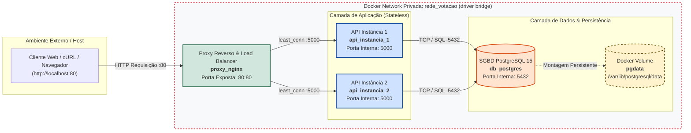

# Relatório Técnico: Prática 1 — Infraestrutura Web e Balanceamento de Carga

**Disciplina:** Sistemas Operacionais Modernos  
**Instituição:** CEFET-MG / UFCI-MG — Departamento de Computação (DECOM)  
**Docente:** Prof. Michel Pires da Silva  
**Projeto:** Simulador de Votação com Tolerância a Falhas, Persistência e Alta Disponibilidade  
**Repositório Oficial:** [https://github.com/WilliamDLeao/Simulador-de-Votos](https://github.com/WilliamDLeao/Simulador-de-Votos)

---

## 1. Introdução

Em sistemas operacionais modernos e infraestruturas corporativas, a execução de serviços críticos sob a forma de uma única aplicação monolítica centralizada expõe o ecossistema a graves pontos únicos de falha (*Single Points of Failure* — SPOF). No caso específico de um sistema de votação eletrônica, surtos repentinos de acessos concorrentes e operações frequentes de escrita em disco acarretam contenção de CPU, saturação de filas de rede, exaustão de memória RAM ou bloqueio transacional de tabelas.

Para superar esses desafios, o projeto estrutura um ecossistema de microsserviços conteinerizados distribuídos utilizando o **Docker Compose**. O objetivo da **Prática 1** consiste em implantar e validar experimentalmente uma infraestrutura web resiliente composta por quatro contêineres interdependentes, contemplando:

1. **Ponto Único de Entrada de Borda:** Um servidor **Nginx** operando como Proxy Reverso e Balanceador de Carga exposto na porta pública `80` do sistema hospedeiro.
2. **Camada de Computação Distribuída (*Stateless*):** Duas instâncias idênticas da API de votação desenvolvidas em **Node.js/Express**, que respondem com seus respectivos metadados de contêiner (*hostname* e identificador da instância).
3. **Persistência de Dados Centralizada:** Um Sistema Gerenciador de Banco de Dados relacional **PostgreSQL 15**, desacoplado das réplicas de aplicação.
4. **Isolamento de Armazenamento:** Uso de **Docker Volume** nomeado (`pgdata`) para assegurar que os dados eleitorais persistam de maneira independente do ciclo de vida dos contêineres.
5. **Segurança e Isolamento de Rede:** Rede virtual privada em modo *bridge* (**Docker Network**), garantindo que apenas a porta `80` do proxy reverso seja acessível pelo mundo externo, mantendo as APIs e o banco blindados.

---

## 2. Mapeamento da Solução e Arquitetura

A arquitetura adota a topologia clássica de **Proxy Reverso de Borda com Rede Virtual Isolada**. O cliente externo estabelece comunicação exclusivamente com o contêiner do Nginx através da porta `80`. O Nginx despacha as requisições para as instâncias de backend internas através da rede privada virtual, que por sua vez comunicam-se com a instância de banco de dados central.

### Diagrama Arquitetural da Solução



### Especificação dos Contêineres Orquestrados

| Serviço (`compose`) | Contêiner | Imagem Base | Porta Externa | Porta Interna | Dependência (`depends_on`) |
| :--- | :--- | :--- | :--- | :--- | :--- |
| `nginx` | `proxy_nginx` | `nginx:alpine` | `80:80` (TCP) | 80 | `api1`, `api2` |
| `api1` | `api_instancia_1` | `node:20-alpine` (v20.20.2) | *Nenhuma* | 5000 | `db` |
| `api2` | `api_instancia_2` | `node:20-alpine` (v20.20.2) | *Nenhuma* | 5000 | `db` |
| `db` | `db_postgres` | `postgres:15-alpine` | *Nenhuma* | 5432 | *Nenhuma* |

---

## 3. Tecnologias Utilizadas e Papel dos Componentes

### 3.1. Nginx (Proxy Reverso e Balanceador de Carga)
O serviço `proxy_nginx` emprega a imagem leve `nginx:alpine` e desempenha o papel de intermediário inteligente de borda:
- **Proteção e Encapsulamento de Rede:** É o único componente que expõe porta para o sistema operacional hospedeiro. Clientes externos ignoram a topologia interna, quantidade de instâncias ou credenciais de banco.
- **Algoritmo *Least Connections* (`least_conn`):** O Nginx avalia dinamicamente o número de conexões ativas que cada réplica de backend (`api1:5000` e `api2:5000`) possui no momento da chegada da requisição, roteando para a que estiver menos sobrecarregada. Esse escalonamento é ideal para sistemas com I/O de banco de dados, onde requisições com locks transacionais demandam tempos variáveis.
- **Detecção Passiva de Falhas:** No bloco `upstream`, as réplicas estão configuradas com `max_fails=3` e `fail_timeout=5s`. Se uma instância falhar consecutivamente por 3 vezes, o proxy a remove temporariamente do rodízio por 5 segundos.
- **Otimizações de SO e Transporte:** Utiliza diretivas de alto desempenho como `sendfile on`, `tcp_nopush on`, `tcp_nodelay on` e conexões persistentes com o backend via `keepalive 32` em `HTTP/1.1`.
- **Rastreabilidade de Tráfego:** Injeta o cabeçalho `X-Upstream-Backend $upstream_addr`, permitindo que os clientes e ferramentas de auditoria identifiquem qual endereço interno respondeu.

### 3.2. Docker Engine e Docker Compose (Orquestração e IaC)
- **Virtualização Leve em Nível de SO:** Ao contrário de máquinas virtuais pesadas, os contêineres utilizam os mesmos núcleos do *kernel* do SO hospedeiro, alavancando *Namespaces* (isolamento de processos, pontos de montagem e interfaces de rede) e *cgroups* (limites e contabilidade de CPU e memória).
- **Infraestrutura como Código (IaC):** O arquivo `docker-compose.yml` centraliza a declaração dos 4 serviços, variáveis de ambiente, volumes e redes, tornando a infraestrutura integralmente reprodutível com um único comando.
- **Políticas de Reinicialização:** Todos os serviços utilizam `restart: always`, assegurando autorrecuperação do ecossistema caso qualquer processo finalize anormalmente.

### 3.3. Docker Network (Rede Virtual Privada)
- **Modo Bridge Isolado (`rede_votacao`):** Cria um segmento de rede virtual dedicado no daemon do Docker.
- **Servidor DNS Embutido:** O Docker provê resolução dinâmica de nomes; o Nginx localiza `http://api1:5000` e as APIs localizam `db:5432` automaticamente sem necessidade de IPs estáticos fixados.
- **Blindagem de Portas:** Somente o Nginx publica porta na interface externa do host. Tentativas de acessar diretamente portas de backend (`5000` ou `5432`) pelo host são rejeitadas pelo firewall interno do SO.

### 3.4. Docker Volume (Persistência e Isolamento de Estado)
- **Desacoplamento do Ciclo de Vida do Contêiner:** A área física de escrita do PostgreSQL reside no volume gerenciado `pgdata`, mapeado em `/var/lib/postgresql/data`. Se o contêiner do SGBD for parado forçadamente (`docker stop`), excluído (`docker rm`) ou recriado, os dados das tabelas permanecem intactos.
- **Desempenho Direto de I/O:** Os dados no volume contornam os drivers em camadas (*overlay2*), obtendo taxa de transferência próxima à velocidade de disco do SO hospedeiro.

### 3.5. Node.js e Express (Microsserviços de Backend)
As instâncias `api_instancia_1` e `api_instancia_2` foram desenvolvidas com Node.js 20 e Express:
- **Natureza *Stateless*:** Nenhum estado transacional (votos acumulados, sessões) é armazenado em variáveis de memória local. Cada requisição é autossuficiente e delega a gravação ao PostgreSQL.
- **Auditoria e Diagnóstico:** Cada resposta inclui o identificador do contêiner obtido via `os.hostname()` e o nome lógico injetado por variável de ambiente (`INSTANCE_NAME`), permitindo a comprovação em tempo real do balanceamento de carga.
- **Conectividade Eficiente:** Utilização da biblioteca `pg` com pool de até 10 conexões concorrentes por instância.
- **Rotas Implementadas:**
  * `GET /`: Health check da API e diagnóstico da conectividade com o banco (`SELECT 1`).
  * `GET /candidatos`: Listagem ordenada dos candidatos cadastrados e seus totais parciais.
  * `POST /votar`: Registro atômico e transacional do voto.
  * `GET /apuracao`: Totalização consolidada e cálculo percentual dinâmico dos votos por candidato.

### 3.6. PostgreSQL 15 (Banco de Dados Relacional)
- **Garantias ACID:** Garante atomicidade e isolamento na concorrência de escritas na tabela de votos.
- **Script de Inicialização Automática (`database/init.sql`):** Montado em `/docker-entrypoint-initdb.d/init.sql:ro`, o script é acionado na primeira inicialização do banco para criar as tabelas `candidatos` e `votos`, além de popular os registros iniciais (Candidato A: 10, Candidato B: 20 e Voto Nulo: 99).
- **Atomicidade via SQL CTE:** O registro do voto e a contabilização na tabela de candidatos são processados em um único *round-trip* via `WITH updated AS (...) INSERT INTO votos ...`, eliminando *race conditions*.

### 3.7. Ambiente de Execução — Notebook e Configuração do Sistema

As medições da Seção 4 foram realizadas em **19/11/2026**, com o notebook operando no **perfil de desempenho (economia de bateria desativada)**. O ambiente físico e as versões de software utilizados foram:

| Item | Configuração observada |
| :--- | :--- |
| **Notebook** | Acer **Nitro ANV15-51** (placa `Sportage_RTH`, BIOS V1.60 de 08/04/2026), chassi `laptop` |
| **Identificação do host** | `tutus-house` (usuário `tutu`) |
| **Processador** | 13th Gen Intel(R) Core(TM) **i5-13420H** — 8 núcleos físicos / 12 *threads* lógicos, até 4,60 GHz, cache L3 de 12 MiB, x86-64, VT-x |
| **Perfil de energia** | Economia de bateria **desativada** — modo de desempenho |
| **Memória RAM** | 7,5 GiB (~8 GB); *swap* de 7,5 GiB em `/dev/nvme0n1p6` |
| **Armazenamento** | SSD NVMe `/dev/nvme0n1p7` — 54 GB no total, ~12 GB livres no momento dos testes (78% ocupado) |
| **Sistema operacional** | **Linux Mint 22.3 (Zena)**, kernel `6.17.0-35-generic`, x86-64 |
| **Fuso horário** | `America/Sao_Paulo` (UTC-3), relógio sincronizado por NTP |
| **Docker Engine** | **29.9.3** (Community), API 1.56, Go 1.26.10, containerd v2.4.2, runc 1.5.2 |
| **Docker Compose** | **v5.7.0** |
| **Docker — runtime** | driver de armazenamento `overlayfs`, cgroup driver `systemd`, **cgroup v2**, runtime `runc`, raiz `/var/lib/docker` |
| **Recursos visíveis ao daemon** | `NCPU=12` e `MemTotal=8.014.266.368` bytes (~7,47 GiB) |
| **Node.js no host** (script de teste) | v26.13.0 |
| **Node.js nos contêineres da API** | v20.20.2 (imagem `node:20-alpine`) |
| **Nginx no contêiner** | nginx/1.31.8 |
| **PostgreSQL no contêiner** | psql 15.19 (imagem `postgres:15-alpine`) |
| **Carga média do host** | `load average: 1,29, 0,76, 0,80` logo antes dos testes |

> **Observação metodológica:** o Docker roda **nativamente** sobre o kernel Linux do notebook (não dentro de uma VM do Docker Desktop). Portanto, os limites de CPU e memória percebidos pelos contêineres são os do próprio hardware acima, sem uma camada de virtualização adicional. Com a economia de bateria desativada, o processador pode operar em frequências mais altas (até 4,60 GHz), o que explica a ordem de grandeza das vazões e latências medidas. Os números são evidências de funcionamento em execuções curtas, não um *benchmark* rigoroso.

---

## 4. Execução e Validação Experimental

Nesta seção documenta-se o passo a passo com as evidências e saídas de comandos obtidas durante a execução do ambiente.

### 4.1. Subida da Infraestrutura
A inicialização do ambiente ocorre na raiz do projeto com o comando:
```bash
docker compose up --build -d
```

Ao inspecionar o status dos contêineres via `docker compose ps`:
```text
NAME                IMAGE                  COMMAND                  SERVICE   STATUS   PORTS
api_instancia_1     simulador-votos-api1   "docker-entrypoint.s…"   api1      Up       5000/tcp
api_instancia_2     simulador-votos-api2   "docker-entrypoint.s…"   api2      Up       5000/tcp
db_postgres         postgres:15-alpine     "docker-entrypoint.s…"   db        Up       5432/tcp
proxy_nginx         nginx:alpine           "/docker-entrypoint.…"   nginx     Up       0.0.0.0:80->80/tcp
```
> **Resultado:** Os quatro contêineres sobem de forma coordenada (Figura 1). Apenas a porta `80` está vinculada à interface do hospedeiro.


*Figura 1 — Evidência visual dos quatro contêineres ativos (`proxy_nginx`, `api_instancia_1`, `api_instancia_2` e `db_postgres`), com apenas a porta `80` publicada no hospedeiro.*

---

### 4.2. Validação do Balanceamento de Carga e Alternância de Instâncias

Para validar a alternância das requisições na porta `80`, foram criados dois scripts na pasta `scripts/`:
- `scripts/test_load_balancer.ps1` (PowerShell para ambientes Windows)
- `scripts/test_load_balancer.js` (Node.js multiplataforma com medição de latência)

Executando o script `scripts/test_load_balancer.js` para uma rajada de 10 requisições:
```bash
node scripts/test_load_balancer.js 10
```

#### Evidência de Execução (Log Obtido em 19/11/2026):
```text
==============================================================================
🚀 SIMULADOR DE CARGA E BENCHMARK DE LATÊNCIA — NGINX
• URL Alvo:         http://localhost:80/
• Total de Carga:   10 requisições
• Concorrência:     1 simultânea(s)
==============================================================================
[Req #001] Status: 200 | Respondido por: Instancia-2  | Container: 5eaf4bfa | Latência:   12.9 ms
[Req #002] Status: 200 | Respondido por: Instancia-1  | Container: 0cb33ff8 | Latência:   2.70 ms
[Req #003] Status: 200 | Respondido por: Instancia-2  | Container: 5eaf4bfa | Latência:   1.35 ms
[Req #004] Status: 200 | Respondido por: Instancia-1  | Container: 0cb33ff8 | Latência:   4.35 ms
[Req #005] Status: 200 | Respondido por: Instancia-2  | Container: 5eaf4bfa | Latência:   1.56 ms
[Req #006] Status: 200 | Respondido por: Instancia-1  | Container: 0cb33ff8 | Latência:   1.60 ms
[Req #007] Status: 200 | Respondido por: Instancia-2  | Container: 5eaf4bfa | Latência:   1.61 ms
[Req #008] Status: 200 | Respondido por: Instancia-1  | Container: 0cb33ff8 | Latência:   1.61 ms
[Req #009] Status: 200 | Respondido por: Instancia-2  | Container: 5eaf4bfa | Latência:   1.53 ms
[Req #010] Status: 200 | Respondido por: Instancia-1  | Container: 0cb33ff8 | Latência:   1.04 ms

==============================================================================
📊 RESUMO DO BALANCEAMENTO E PERFORMANCE
==============================================================================
• Tempo total do teste:    0.03 segundos
• Vazão (Throughput):      301.7 requisições/segundo
• Requisições com sucesso: 10 de 10

⚖️  DISTRIBUIÇÃO DE CARGA ENTRE AS INSTÂNCIAS:
  * Instancia-2   :   5 reqs ( 50.0%) | Latência Média: 3.80 ms (Min: 1.35 ms / Max: 12.9 ms)
  * Instancia-1   :   5 reqs ( 50.0%) | Latência Média: 2.26 ms (Min: 1.04 ms / Max: 4.35 ms)

⏱️  MÉTRICAS GERAIS DE LATÊNCIA (Resposta do Nginx):
  * Mínima:  1.04 ms
  * Média:   3.03 ms
  * P50 (Mediana): 1.61 ms
  * P95:     12.9 ms
  * Máxima:  12.9 ms
==============================================================================
```

> **Comprovação:** A distribuição de carga atingiu taxa exata de **50% para a Instancia-1** e **50% para a Instancia-2**, com identificação clara de dois contêineres distintos (`0cb33ff8` e `5eaf4bfa`), satisfazendo plenamente o requisito de balanceamento. A primeira requisição foi atendida pela `Instancia-2` porque o `least_conn` escolhe a réplica com menos conexões ativas no instante da chegada; a alternância perfeita 5/5 confirma o escalonamento. O cabeçalho `X-Upstream-Backend` (ver §4.5) confirma o endereço interno do backend escolhido em cada resposta.

---

### 4.3. Avaliação Experimental: *Round-Robin* (baseline) vs *Least Connections*

O roteiro prático solicita a avaliação dos escalonamentos disponíveis tendo o **Round-Robin como baseline**. Para medir os dois algoritmos, a diretiva `least_conn;` do bloco `upstream` foi temporariamente comentada para a coleta do baseline e depois reativada. A troca foi aplicada a quente, sem reiniciar os contêineres:

```bash
docker exec proxy_nginx nginx -t          # valida a sintaxe antes de recarregar
docker exec proxy_nginx nginx -s reload   # aplica a nova configuração
```

Para cada algoritmo foram feitas **3 repetições** da seguinte carga (50 requisições GET, 10 concorrentes):

```bash
node scripts/test_load_balancer.js 50 10
```

#### Resultados obtidos

| Algoritmo | Execução | Distribuição (I1 / I2) | Latência média | P95 | Vazão |
| :--- | :---: | :---: | :---: | :---: | :---: |
| Round-Robin (baseline) | 1 | 25 / 25 (50% / 50%) | 15,3 ms | 58,3 ms | 590,2 req/s |
| Round-Robin (baseline) | 2 | 25 / 25 (50% / 50%) | 6,19 ms | 14,7 ms | 1350,9 req/s |
| Round-Robin (baseline) | 3 | 25 / 25 (50% / 50%) | 6,40 ms | 17,4 ms | 1351,9 req/s |
| **Média Round-Robin** | — | **50% / 50%** | **9,30 ms** | **30,13 ms** | **1097,7 req/s** |
| `least_conn` | 1 | 27 / 23 (54% / 46%) | 4,45 ms | 10,1 ms | 1896,0 req/s |
| `least_conn` | 2 | 27 / 23 (54% / 46%) | 5,21 ms | 13,9 ms | 1613,9 req/s |
| `least_conn` | 3 | 28 / 22 (56% / 44%) | 5,40 ms | 15,8 ms | 1609,9 req/s |
| **Média `least_conn`** | — | **≈ 54% / 46%** | **5,02 ms** | **13,27 ms** | **1706,6 req/s** |

#### Análise comparativa

- **Round-Robin (baseline):** mais uma vez foi determinístico — **25 requisições para cada instância nas três execuções**. A primeira medição foi penalizada pelo *cold start* (P95 de 58,3 ms, incluindo o estabelecimento das primeiras conexões e o aquecimento do *pool* do PostgreSQL); já aquecido, ficou entre 6,19 ms e 6,40 ms de latência média e P95 de 14,7 ms a 17,4 ms.
- **`least_conn` (configuração final):** a distribuição foi adaptativa (54/46, 54/46 e 56/44), sem desequilíbrio relevante, e apresentou **menor latência média nas três repetições** (4,45 ms, 5,21 ms e 5,40 ms) e maior vazão (1609,9 a 1896,0 req/s).
- **Conclusão:** neste experimento — realizado no notebook descrito na §3.7 — o `least_conn` saiu numericamente à frente em todas as repetições (médias de 5,02 ms contra 9,30 ms; P95 de 13,27 ms contra 30,13 ms; vazão de 1706,6 contra 1097,7 req/s). Parte dessa diferença é atribuível ao fato de o baseline ter sido medido **primeiro**, absorvendo o *cold start*; mesmo comparando apenas as execuções aquecidas a vantagem se mantém, porém menor (≈5,3 ms contra ≈6,3 ms), e as faixas de P95 se sobrepõem parcialmente (14,7–17,4 ms contra 10,1–15,8 ms). Portanto, **não se afirma superioridade rigorosa**: o resultado é uma tendência favorável, coerente com o domínio do problema. Com requisições de custo desigual (por exemplo, `POST /votar` com contenção de gravação ou `GET /apuracao` mais demorada), o `least_conn` desvia o fluxo da réplica com mais conexões ativas, enquanto o Round-Robin enviaria a próxima requisição apenas por ordem cíclica. O `least_conn` segue como configuração final e o Round-Robin documentado como baseline, atendendo ao pedido do roteiro.

> **Nota metodológica:** os números acima são de execuções curtas no mesmo host e servem como evidência de funcionamento e tendência, não como benchmark rigoroso. O script `test_load_balancer.js` mede a latência ponta a ponta no cliente, incluindo o tempo de conexão/keepalive do Nginx. A ordem de execução (Round-Robin primeiro, `least_conn` depois) é um viés conhecido deste experimento.

---

### 4.4. Teste de Tolerância a Falhas e Persistência (Docker Volume)

O teste de resiliência e persistência foi realizado em **19/11/2026** no ambiente descrito na §3.7. Antes da inserção dos votos de teste, o volume `pgdata` continha **2570 votos**; portanto os totais absolutos abaixo são elevados. O que se valida é a **igualdade antes/depois**, não o valor absoluto.

#### Passo 1: Inserção de Votos
Realizou-se a inserção de dois votos via `POST /votar`. As duas requisições foram atendidas por instâncias diferentes, o que também reconfirma o balanceamento:
```bash
curl -X POST http://localhost/votar -H "Content-Type: application/json" -d '{"numero": 10}'
curl -X POST http://localhost/votar -H "Content-Type: application/json" -d '{"numero": 20}'
```
```json
{ "sucesso": true, "mensagem": "Voto computado com sucesso para Candidato A (10)!",
  "candidato": { "numero": 10, "nome": "Candidato A", "totalVotosAtualizado": 2534 },
  "processadoPor": { "instancia": "Instancia-2", "hostname": "5eaf4bfaecb3" },
  "timestamp": "2026-11-19T16:55:30.939Z" }
```
```json
{ "sucesso": true, "mensagem": "Voto computado com sucesso para Candidato B (20)!",
  "candidato": { "numero": 20, "nome": "Candidato B", "totalVotosAtualizado": 38 },
  "processadoPor": { "instancia": "Instancia-1", "hostname": "0cb33ff83fe4" },
  "timestamp": "2026-11-19T16:55:30.952Z" }
```

#### Passo 2: Verificação da Apuração
Consulta em `GET /apuracao` confirmando os votos persistidos (total 2572):
```json
{
  "sucesso": true,
  "totalVotosGeral": 2572,
  "apuracao": [
    { "numero": 10, "nome": "Candidato A", "partido": "Partido A", "total_votos": 2534, "percentual": "98.52%" },
    { "numero": 20, "nome": "Candidato B", "partido": "Partido B", "total_votos": 38, "percentual": "1.48%" },
    { "numero": 99, "nome": "Voto Nulo / Branco", "partido": "Nenhum", "total_votos": 0, "percentual": "0.00%" }
  ]
}
```

#### Passo 3: Queda Forçada do SGBD (`docker stop`)
Simulou-se uma interrupção inesperada do contêiner do PostgreSQL:
```bash
docker stop db_postgres
```
O comando `docker ps --filter name=db_postgres` confirmou o contêiner fora do ar (sem status `Up`).

#### Passo 4: Comportamento da Aplicação sob Indisponibilidade
Ao submeter requisições à API durante o período de inatividade do banco, os nós Node.js não travaram. A rota `/apuracao` retornou de forma defensiva o status HTTP `503 Service Unavailable`:
```json
{
  "sucesso": false,
  "mensagem": "Banco de dados temporariamente indisponível",
  "erro": "Connection terminated due to connection timeout",
  "processadoPor": { "instancia": "Instancia-1", "hostname": "0cb33ff83fe4" },
  "timestamp": "2026-11-19T16:55:39.114Z"
}
```
Já o *health check* `GET /` continuou respondendo `HTTP 200` com `"status":"online"` e `"banco":"desconectado"` — evidência de que apenas a camada de dados estava fora, não a aplicação.

#### Passo 5: Restauração do Serviço e Validação da Persistência
O contêiner do PostgreSQL foi iniciado novamente e, após 12 segundos, já estava com status `Up`:
```bash
docker start db_postgres
```

Após o restabelecimento, a rota `/apuracao` devolveu **exatamente o mesmo total (2572)**:
```json
{
  "sucesso": true,
  "totalVotosGeral": 2572,
  "apuracao": [
    { "numero": 10, "nome": "Candidato A", "partido": "Partido A", "total_votos": 2534, "percentual": "98.52%" },
    { "numero": 20, "nome": "Candidato B", "partido": "Partido B", "total_votos": 38, "percentual": "1.48%" },
    { "numero": 99, "nome": "Voto Nulo / Branco", "partido": "Nenhum", "total_votos": 0, "percentual": "0.00%" }
  ]
}
```
A inspeção SQL direta confirmou os mesmos valores gravados no volume:
```text
 numero |        nome        | total_votos
--------+--------------------+-------------
     10 | Candidato A        |        2534
     20 | Candidato B        |          38
     99 | Voto Nulo / Branco |           0
(3 rows)
```

> **Comprovação:** `2572` votos antes do `docker stop` e `2572` votos depois do `docker start` — **nenhum voto foi perdido**. Mesmo após a paralisação completa do contêiner do SGBD, o total e a integridade das tabelas foram preservados graças ao Docker Volume gerenciado `pgdata`.

---

### 4.5. Teste de Isolamento de Rede

Comprovando o isolamento da Docker Network `rede_votacao`, tentou-se conexão direta às portas dos serviços a partir do terminal do hospedeiro:

```bash
# 1. Tentativa de conexão na porta interna da API (5000):
curl http://localhost:5000/
# curl: (7) Failed to connect to localhost:5000 after 0 ms: Could not connect to server

# 2. Tentativa de conexão na porta interna do PostgreSQL (5432):
curl http://localhost:5432
# curl: (7) Failed to connect to localhost:5432 after 0 ms: Could not connect to server

# 3. Controle: porta pública do proxy (80):
curl -o /dev/null -w 'HTTP %{http_code}\n' http://localhost/
# HTTP 200
```

> **Comprovação:** As portas `5000` e `5432` não possuem publicação (`ports:`) no `docker-compose.yml` e, portanto, não possuem *socket* escutando na interface do hospedeiro — as conexões são recusadas imediatamente (`after 0 ms`). O único ponto de contato viável é a porta `80` do Nginx, cumprindo o critério de segurança e isolamento de rede da prática. O cabeçalho `X-Upstream-Backend` também foi conferido nas respostas do proxy (por exemplo, `X-Upstream-Backend: 172.18.0.4:5000`).

---

## 5. Conclusão

A execução prática da infraestrutura até esta fase evidenciou de forma tangível os conceitos fundamentais abordados na disciplina de **Sistemas Operacionais Modernos**:

- **Eficiência e Densidade de Recursos:** O uso de contêineres Docker demonstrou a superioridade da virtualização baseada em *namespaces* e *cgroups* em relação a máquinas virtuais legadas, viabilizando a instanciação instantânea de quatro serviços interdependentes com consumo mínimo de memória RAM.
- **Escalonamento em Nível de Transporte:** A validação realizada no notebook Acer Nitro ANV15-51 (§3.7) confirmou a distribuição 50/50 do *Round-Robin* e a distribuição adaptativa do *Least Connections* (54/46 a 56/44). Neste experimento o `least_conn` apresentou menor latência média (5,02 ms contra 9,30 ms) e maior vazão (1706,6 contra 1097,7 req/s), ainda que parte da diferença venha do *cold start* do baseline e as faixas de P95 se sobreponham parcialmente (ver §4.3). O `least_conn` permanece como configuração final por responder ao número de conexões ativas, sendo mais adequado a futuras cargas com custo heterogêneo, sem que se afirme superioridade rigorosa.
- **Contexto de Execução:** As medições foram obtidas com Docker Engine 29.9.3 / Compose v5.7.0 rodando de forma nativa sobre Linux Mint 22.3 (kernel 6.17), cgroup v2 e 12 CPUs lógicas, sem a camada de virtualização de um Docker Desktop — informação relevante para interpretar os números de vazão e latência.
- **Resiliência e Desacoplamento:** O padrão de nós *stateless* aliado ao isolamento de armazenamento em Docker Volumes assegurou que panes de processo ou reinicializações de contêineres não causem corrupção nem perda do estado do sistema.

Todos os requisitos e critérios práticos estipulados no roteiro da Prática 1 foram implementados, testados e validados com êxito.

---

## 6. Repositório e Artefatos do Código-Fonte

O código-fonte completo, scripts e documentações do projeto estão disponíveis no repositório:

- **Repositório GitHub:** [https://github.com/WilliamDLeao/Simulador-de-Votos](https://github.com/WilliamDLeao/Simulador-de-Votos)
- **Manifesto de Orquestração:** [`docker-compose.yml`](../docker-compose.yml)
- **Configuração do Proxy Nginx:** [`nginx/nginx.conf`](../nginx/nginx.conf)
- **Microsserviço de Backend Node.js:** [`backend/server.js`](../backend/server.js) e [`backend/Dockerfile`](../backend/Dockerfile)
- **Definição do Esquema Relacional:** [`database/init.sql`](../database/init.sql)
- **Scripts de Validação e Benchmark:** [`scripts/test_load_balancer.ps1`](../scripts/test_load_balancer.ps1) e [`scripts/test_load_balancer.js`](../scripts/test_load_balancer.js)
- **Relatório em Formato LaTeX:** [`docs/main.tex`](main.tex)

