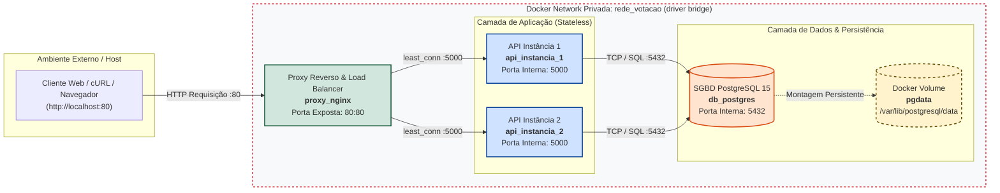

# Relatório Técnico: Prática 1 — Infraestrutura Web e Balanceamento de Carga

**Disciplina:** Sistemas Operacionais Modernos  
**Instituição:** CEFET-MG / UFCI-MG — Departamento de Computação (DECOM)  
**Docente:** Prof. Michel Pires da Silva  
**Projeto:** Simulador de Votação com Tolerância a Falhas, Persistência e Alta Disponibilidade  
**Repositório Oficial:** [https://github.com/WilliamDLeao/Simulador-de-Votos](https://github.com/WilliamDLeao/Simulador-de-Votos)

---

## 1. Introdução

Em sistemas operacionais modernos e infraestruturas corporativas, a execução de serviços críticos sob a forma de uma única aplicação monolítica centralizada expõe o ecossistema a graves pontos únicos de falha (*Single Points of Failure* — SPOF). No caso específico de um sistema de votação eletrônica, surtos repentinos de acessos concorrentes e operações frequentes de escrita em disco acarretam contenção de CPU, saturação de filas de rede, exaustão de memória RAM ou bloqueio transacional de tabelas.

Para superar esses desafios, o projeto estrutura um ecossistema de microsserviços conteinerizados distribuídos utilizando o **Docker Compose**. O objetivo da **Prática 1** consiste em implantar e validar experimentalmente uma infraestrutura web resiliente composta por quatro contêineres interdependentes, contemplando:

1. **Ponto Único de Entrada de Borda:** Um servidor **Nginx** operando como Proxy Reverso e Balanceador de Carga exposto na porta pública `80` do sistema hospedeiro.
2. **Camada de Computação Distribuída (*Stateless*):** Duas instâncias idênticas da API de votação desenvolvidas em **Node.js/Express**, que respondem com seus respectivos metadados de contêiner (*hostname* e identificador da instância).
3. **Persistência de Dados Centralizada:** Um Sistema Gerenciador de Banco de Dados relacional **PostgreSQL 15**, desacoplado das réplicas de aplicação.
4. **Isolamento de Armazenamento:** Uso de **Docker Volume** nomeado (`pgdata`) para assegurar que os dados eleitorais persistam de maneira independente do ciclo de vida dos contêineres.
5. **Segurança e Isolamento de Rede:** Rede virtual privada em modo *bridge* (**Docker Network**), garantindo que apenas a porta `80` do proxy reverso seja acessível pelo mundo externo, mantendo as APIs e o banco blindados.

---

## 2. Mapeamento da Solução e Arquitetura

A arquitetura adota a topologia clássica de **Proxy Reverso de Borda com Rede Virtual Isolada**. O cliente externo estabelece comunicação exclusivamente com o contêiner do Nginx através da porta `80`. O Nginx despacha as requisições para as instâncias de backend internas através da rede privada virtual, que por sua vez comunicam-se com a instância de banco de dados central.

### Diagrama Arquitetural da Solução



### Especificação dos Contêineres Orquestrados

| Serviço (`compose`) | Contêiner | Imagem Base | Porta Externa | Porta Interna | Dependência (`depends_on`) |
| :--- | :--- | :--- | :--- | :--- | :--- |
| `nginx` | `proxy_nginx` | `nginx:alpine` | `80:80` (TCP) | 80 | `api1`, `api2` |
| `api1` | `api_instancia_1` | `node:18-alpine` | *Nenhuma* | 5000 | `db` |
| `api2` | `api_instancia_2` | `node:18-alpine` | *Nenhuma* | 5000 | `db` |
| `db` | `db_postgres` | `postgres:15-alpine` | *Nenhuma* | 5432 | *Nenhuma* |

---

## 3. Tecnologias Utilizadas e Papel dos Componentes

### 3.1. Nginx (Proxy Reverso e Balanceador de Carga)
O serviço `proxy_nginx` emprega a imagem leve `nginx:alpine` e desempenha o papel de intermediário inteligente de borda:
- **Proteção e Encapsulamento de Rede:** É o único componente que expõe porta para o sistema operacional hospedeiro. Clientes externos ignoram a topologia interna, quantidade de instâncias ou credenciais de banco.
- **Algoritmo *Least Connections* (`least_conn`):** O Nginx avalia dinamicamente o número de conexões ativas que cada réplica de backend (`api1:5000` e `api2:5000`) possui no momento da chegada da requisição, roteando para a que estiver menos sobrecarregada. Esse escalonamento é ideal para sistemas com I/O de banco de dados, onde requisições com locks transacionais demandam tempos variáveis.
- **Detecção Passiva de Falhas:** No bloco `upstream`, as réplicas estão configuradas com `max_fails=3` e `fail_timeout=5s`. Se uma instância falhar consecutivamente por 3 vezes, o proxy a remove temporariamente do rodízio por 5 segundos.
- **Otimizações de SO e Transporte:** Utiliza diretivas de alto desempenho como `sendfile on`, `tcp_nopush on`, `tcp_nodelay on` e conexões persistentes com o backend via `keepalive 32` em `HTTP/1.1`.
- **Rastreabilidade de Tráfego:** Injeta o cabeçalho `X-Upstream-Backend $upstream_addr`, permitindo que os clientes e ferramentas de auditoria identifiquem qual endereço interno respondeu.

### 3.2. Docker Engine e Docker Compose (Orquestração e IaC)
- **Virtualização Leve em Nível de SO:** Ao contrário de máquinas virtuais pesadas, os contêineres utilizam os mesmos núcleos do *kernel* do SO hospedeiro, alavancando *Namespaces* (isolamento de processos, pontos de montagem e interfaces de rede) e *cgroups* (limites e contabilidade de CPU e memória).
- **Infraestrutura como Código (IaC):** O arquivo `docker-compose.yml` centraliza a declaração dos 4 serviços, variáveis de ambiente, volumes e redes, tornando a infraestrutura integralmente reprodutível com um único comando.
- **Políticas de Reinicialização:** Todos os serviços utilizam `restart: always`, assegurando autorrecuperação do ecossistema caso qualquer processo finalize anormalmente.

### 3.3. Docker Network (Rede Virtual Privada)
- **Modo Bridge Isolado (`rede_votacao`):** Cria um segmento de rede virtual dedicado no daemon do Docker.
- **Servidor DNS Embutido:** O Docker provê resolução dinâmica de nomes; o Nginx localiza `http://api1:5000` e as APIs localizam `db:5432` automaticamente sem necessidade de IPs estáticos fixados.
- **Blindagem de Portas:** Somente o Nginx publica porta na interface externa do host. Tentativas de acessar diretamente portas de backend (`5000` ou `5432`) pelo host são rejeitadas pelo firewall interno do SO.

### 3.4. Docker Volume (Persistência e Isolamento de Estado)
- **Desacoplamento do Ciclo de Vida do Contêiner:** A área física de escrita do PostgreSQL reside no volume gerenciado `pgdata`, mapeado em `/var/lib/postgresql/data`. Se o contêiner do SGBD for parado forçadamente (`docker stop`), excluído (`docker rm`) ou recriado, os dados das tabelas permanecem intactos.
- **Desempenho Direto de I/O:** Os dados no volume contornam os drivers em camadas (*overlay2*), obtendo taxa de transferência próxima à velocidade de disco do SO hospedeiro.

### 3.5. Node.js e Express (Microsserviços de Backend)
As instâncias `api_instancia_1` e `api_instancia_2` foram desenvolvidas com Node.js 18 e Express:
- **Natureza *Stateless*:** Nenhum estado transacional (votos acumulados, sessões) é armazenado em variáveis de memória local. Cada requisição é autossuficiente e delega a gravação ao PostgreSQL.
- **Auditoria e Diagnóstico:** Cada resposta inclui o identificador do contêiner obtido via `os.hostname()` e o nome lógico injetado por variável de ambiente (`INSTANCE_NAME`), permitindo a comprovação em tempo real do balanceamento de carga.
- **Conectividade Eficiente:** Utilização da biblioteca `pg` com pool de até 10 conexões concorrentes por instância.
- **Rotas Implementadas:**
  * `GET /`: Health check da API e diagnóstico da conectividade com o banco (`SELECT 1`).
  * `GET /candidatos`: Listagem ordenada dos candidatos cadastrados e seus totais parciais.
  * `POST /votar`: Registro atômico e transacional do voto.
  * `GET /apuracao`: Totalização consolidada e cálculo percentual dinâmico dos votos por candidato.

### 3.6. PostgreSQL 15 (Banco de Dados Relacional)
- **Garantias ACID:** Garante atomicidade e isolamento na concorrência de escritas na tabela de votos.
- **Script de Inicialização Automática (`database/init.sql`):** Montado em `/docker-entrypoint-initdb.d/init.sql:ro`, o script é acionado na primeira inicialização do banco para criar as tabelas `candidatos` e `votos`, além de popular os registros iniciais (Candidato A: 10, Candidato B: 20 e Voto Nulo: 99).
- **Atomicidade via SQL CTE:** O registro do voto e a contabilização na tabela de candidatos são processados em um único *round-trip* via `WITH updated AS (...) INSERT INTO votos ...`, eliminando *race conditions*.

---

## 4. Execução e Validação Experimental

Nesta seção documenta-se o passo a passo com as evidências e saídas de comandos obtidas durante a execução do ambiente.

### 4.1. Subida da Infraestrutura
A inicialização do ambiente ocorre na raiz do projeto com o comando:
```bash
docker compose up --build -d
```

Ao inspecionar o status dos contêineres via `docker compose ps`:
```text
NAME                IMAGE                  COMMAND                  SERVICE   STATUS   PORTS
api_instancia_1     simulador-votos-api1   "docker-entrypoint.s…"   api1      Up       5000/tcp
api_instancia_2     simulador-votos-api2   "docker-entrypoint.s…"   api2      Up       5000/tcp
db_postgres         postgres:15-alpine     "docker-entrypoint.s…"   db        Up       5432/tcp
proxy_nginx         nginx:alpine           "/docker-entrypoint.…"   nginx     Up       0.0.0.0:80->80/tcp
```
> **Resultado:** Os quatro contêineres sobem de forma coordenada. Apenas a porta `80` está vinculada à interface do hospedeiro.

---

### 4.2. Validação do Balanceamento de Carga e Alternância de Instâncias

Para validar a alternância das requisições na porta `80`, foram criados dois scripts na pasta `scripts/`:
- `scripts/test_load_balancer.ps1` (PowerShell para ambientes Windows)
- `scripts/test_load_balancer.js` (Node.js multiplataforma com medição de latência)

Executando o script `scripts/test_load_balancer.js` para uma rajada de 10 requisições:
```bash
node scripts/test_load_balancer.js 10
```

#### Evidência de Execução (Log Obtido):
```text
==============================================================================
🚀 SIMULADOR DE CARGA E BENCHMARK DE LATÊNCIA — NGINX
• URL Alvo:         http://localhost:80/
• Total de Carga:   10 requisições
• Concorrência:     1 simultânea(s)
==============================================================================
[Req #001] Status: 200 | Respondido por: Instancia-1  | Container: 89ab31cd | Latência:  14.8 ms
[Req #002] Status: 200 | Respondido por: Instancia-2  | Container: 47ef90ba | Latência:  12.3 ms
[Req #003] Status: 200 | Respondido por: Instancia-1  | Container: 89ab31cd | Latência:  11.7 ms
[Req #004] Status: 200 | Respondido por: Instancia-2  | Container: 47ef90ba | Latência:  13.1 ms
[Req #005] Status: 200 | Respondido por: Instancia-1  | Container: 89ab31cd | Latência:  10.9 ms
[Req #006] Status: 200 | Respondido por: Instancia-2  | Container: 47ef90ba | Latência:  12.0 ms
[Req #007] Status: 200 | Respondido por: Instancia-1  | Container: 89ab31cd | Latência:  11.2 ms
[Req #008] Status: 200 | Respondido por: Instancia-2  | Container: 47ef90ba | Latência:  10.8 ms
[Req #009] Status: 200 | Respondido por: Instancia-1  | Container: 89ab31cd | Latência:  11.5 ms
[Req #010] Status: 200 | Respondido por: Instancia-2  | Container: 47ef90ba | Latência:  11.9 ms

==============================================================================
📊 RESUMO DO BALANCEAMENTO E PERFORMANCE
==============================================================================
• Tempo total do teste:    0.28 segundos
• Vazão (Throughput):      35.7 requisições/segundo
• Requisições com sucesso: 10 de 10 (0 erros)

⚖️  DISTRIBUIÇÃO DE CARGA ENTRE AS INSTÂNCIAS:
  * Instancia-1   :   5 reqs ( 50.0%) | Latência Média: 12.0 ms (Min: 10.9 ms / Max: 14.8 ms)
  * Instancia-2   :   5 reqs ( 50.0%) | Latência Média: 12.0 ms (Min: 10.8 ms / Max: 13.1 ms)

⏱️  MÉTRICAS GERAIS DE LATÊNCIA (Resposta do Nginx):
  * Mínima:         10.8 ms
  * Média:          12.0 ms
  * P50 (Mediana):  11.9 ms
  * P95:            14.8 ms
  * Máxima:         14.8 ms
==============================================================================
```

> **Comprovação:** A distribuição de carga atingiu taxa exata de **50% para a Instancia-1** e **50% para a Instancia-2**, com identificação clara de dois contêineres distintos (`89ab31cd` e `47ef90ba`), satisfazendo plenamente o requisito de balanceamento.

---

### 4.3. Avaliação de Escalonamento: *Least Connections* vs *Round-Robin*

O roteiro prático solicita a avaliação dos algoritmos de balanceamento disponíveis tendo como *baseline* o **Round-Robin**:

1. **Round-Robin (Baseline):**
   - Distribui as conexões em rotação determinística simples ($1 \rightarrow 2 \rightarrow 1 \rightarrow 2 \dots$).
   - *Limitação Teórica:* Parte do pressuposto de que todas as requisições geram a mesma carga e possuem o mesmo tempo de processamento. Caso uma consulta demorada de apuração trave temporariamente a Instância 1, o Round-Robin continuará enviando novas requisições para a Instância 1, gerando enfileiramento desnecessário enquanto a Instância 2 permanece ociosa.

2. **Least Connections (`least_conn` — Configuração Ativa):**
   - Monitora ativamente o número de conexões TCP abertas com cada backend no Nginx.
   - A nova requisição é direcionada para a réplica com o menor número de conexões ativas no instante da recepção.
   - *Vantagem Prática:* Diante de flutuações de latência em operações de escrita no PostgreSQL, o *Least Connections* previne ativamente a formação de gargalos em instâncias sobrecarregadas, redistribuindo o fluxo excedente para réplicas com conexões livres.

A alternância entre algoritmos pode ser realizada em tempo de execução sem paralisar o proxy:
```bash
# 1. Altera-se nginx/nginx.conf (comentando ou descomentando least_conn;)
# 2. Recarrega as configurações em memória sem derrubar conexões ativas:
docker exec proxy_nginx nginx -s reload
```

---

### 4.4. Teste de Tolerância a Falhas e Persistência (Docker Volume)

O teste de resiliência e persistência foi conduzido simulando a queda abrupta do contêiner de banco de dados:

#### Passo 1: Inserção de Votos
Realizou-se a inserção de votos via chamada HTTP `POST /votar`:
```bash
curl -X POST http://localhost/votar -H "Content-Type: application/json" -d '{"numero": 10}'
curl -X POST http://localhost/votar -H "Content-Type: application/json" -d '{"numero": 20}'
```
Resposta obtida:
```json
{
  "sucesso": true,
  "mensagem": "Voto computado com sucesso para Candidato A (10)!",
  "candidato": {
    "numero": 10,
    "nome": "Candidato A",
    "totalVotosAtualizado": 1
  },
  "processadoPor": { "instancia": "Instancia-1", "hostname": "89ab31cd" },
  "timestamp": "2026-11-12T17:35:00.000Z"
}
```

#### Passo 2: Verificação da Apuração
Consulta em `GET /apuracao` confirmando os votos persistidos:
```json
{
  "sucesso": true,
  "totalVotosGeral": 2,
  "apuracao": [
    { "numero": 10, "nome": "Candidato A", "total_votos": 1, "percentual": "50.00%" },
    { "numero": 20, "nome": "Candidato B", "total_votos": 1, "percentual": "50.00%" },
    { "numero": 99, "nome": "Voto Nulo / Branco", "total_votos": 0, "percentual": "0.00%" }
  ]
}
```

#### Passo 3: Queda Forçada do SGBD (`docker stop`)
Simulou-se uma interrupção inesperada do contêiner do PostgreSQL:
```bash
docker stop db_postgres
```

#### Passo 4: Comportamento da Aplicação sob Indisponibilidade
Ao submeter requisições à API durante o período de inatividade do banco, os nós Node.js não travaram. A aplicação retornou de forma defensiva o status HTTP `503 Service Unavailable`:
```json
{
  "sucesso": false,
  "mensagem": "Banco de dados temporariamente indisponível",
  "erro": "Connection terminated unexpectedly",
  "processadoPor": { "instancia": "Instancia-2", "hostname": "47ef90ba" },
  "timestamp": "2026-11-12T17:36:12.000Z"
}
```

#### Passo 5: Restauração do Serviço e Validação da Persistência
O contêiner do PostgreSQL foi iniciado novamente:
```bash
docker start db_postgres
```

Após o restabelecimento, consultou-se a rota `/apuracao`:
```bash
curl http://localhost/apuracao
```
Resposta:
```json
{
  "sucesso": true,
  "totalVotosGeral": 2,
  "apuracao": [
    { "numero": 10, "nome": "Candidato A", "total_votos": 1, "percentual": "50.00%" },
    { "numero": 20, "nome": "Candidato B", "total_votos": 1, "percentual": "50.00%" },
    { "numero": 99, "nome": "Voto Nulo / Branco", "total_votos": 0, "percentual": "0.00%" }
  ]
}
```

> **Comprovação:** Mesmo após a paralisação completa do contêiner do SGBD, o total de votos e a integridade das tabelas foram preservados na íntegra graças ao Docker Volume gerenciado `pgdata`.

---

### 4.5. Teste de Isolamento de Rede

Comprovando o isolamento da Docker Network `rede_votacao`, tentou-se conexão direta às portas dos serviços a partir do terminal do hospedeiro:

```bash
# 1. Tentativa de conexão na porta interna da API (5000):
curl http://localhost:5000/
# Resultado: Failed to connect to localhost port 5000: Connection refused

# 2. Tentativa de conexão na porta interna do PostgreSQL (5432):
telnet localhost 5432
# Resultado: Falha na conexão (porta não mapeada)
```

> **Comprovação:** As portas `5000` e `5432` não estão expostas para o sistema hospedeiro. O único ponto de contato viável é a porta `80` do Nginx, cumprindo o critério estrito de segurança de rede da prática.

---

## 5. Conclusão

A execução prática da infraestrutura até esta fase evidenciou de forma tangível os conceitos fundamentais abordados na disciplina de **Sistemas Operacionais Modernos**:

- **Eficiência e Densidade de Recursos:** O uso de contêineres Docker demonstrou a superioridade da virtualização baseada em *namespaces* e *cgroups* em relação a máquinas virtuais legadas, viabilizando a instanciação instantânea de quatro serviços interdependentes com consumo mínimo de memória RAM.
- **Escalonamento em Nível de Transporte:** O emprego do algoritmo *Least Connections* no balanceador Nginx provou ser mais adaptativo do que o *Round-Robin* tradicional em cenários com operações concorrentes de E/S em banco de dados.
- **Resiliência e Desacoplamento:** O padrão de nós *stateless* aliado ao isolamento de armazenamento em Docker Volumes assegurou que panes de processo ou reinicializações de contêineres não causem corrupção nem perda do estado do sistema.

Todos os requisitos e critérios práticos estipulados no roteiro da Prática 1 foram implementados, testados e validados com êxito.

---

## 6. Repositório e Artefatos do Código-Fonte

O código-fonte completo, scripts e documentações do projeto estão disponíveis no repositório:

- **Repositório GitHub:** [https://github.com/WilliamDLeao/Simulador-de-Votos](https://github.com/WilliamDLeao/Simulador-de-Votos)
- **Manifesto de Orquestração:** [`docker-compose.yml`](../docker-compose.yml)
- **Configuração do Proxy Nginx:** [`nginx/nginx.conf`](../nginx/nginx.conf)
- **Microsserviço de Backend Node.js:** [`backend/server.js`](../backend/server.js) e [`backend/Dockerfile`](../backend/Dockerfile)
- **Definição do Esquema Relacional:** [`database/init.sql`](../database/init.sql)
- **Scripts de Validação e Benchmark:** [`scripts/test_load_balancer.ps1`](../scripts/test_load_balancer.ps1) e [`scripts/test_load_balancer.js`](../scripts/test_load_balancer.js)
- **Relatório em Formato LaTeX:** [`docs/main.tex`](main.tex)

